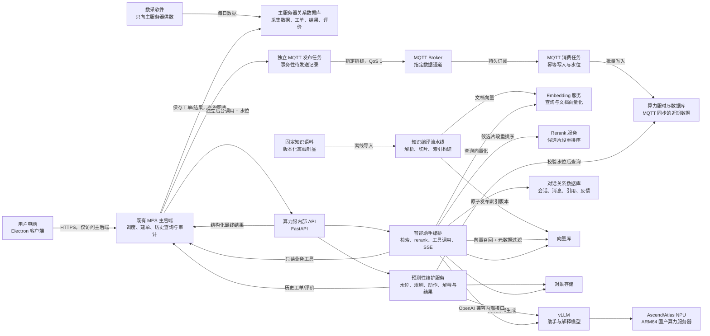
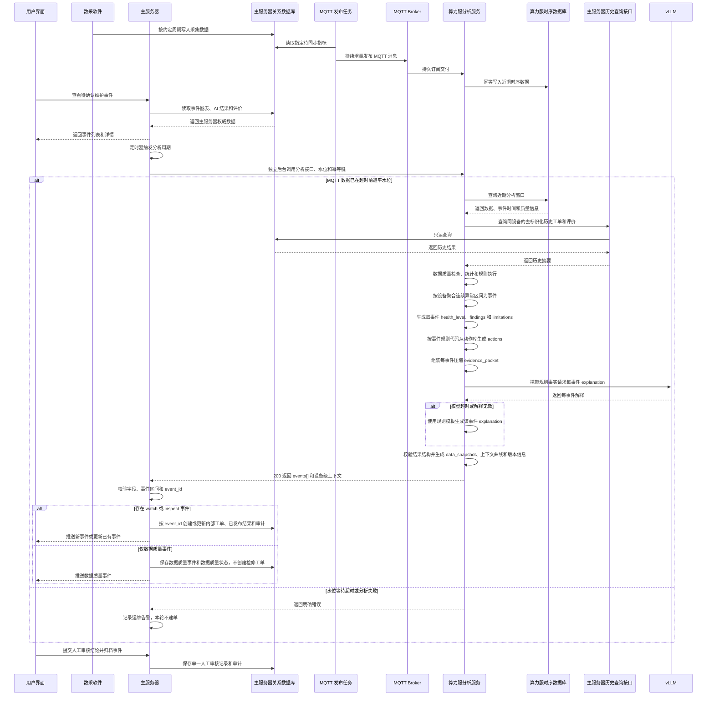
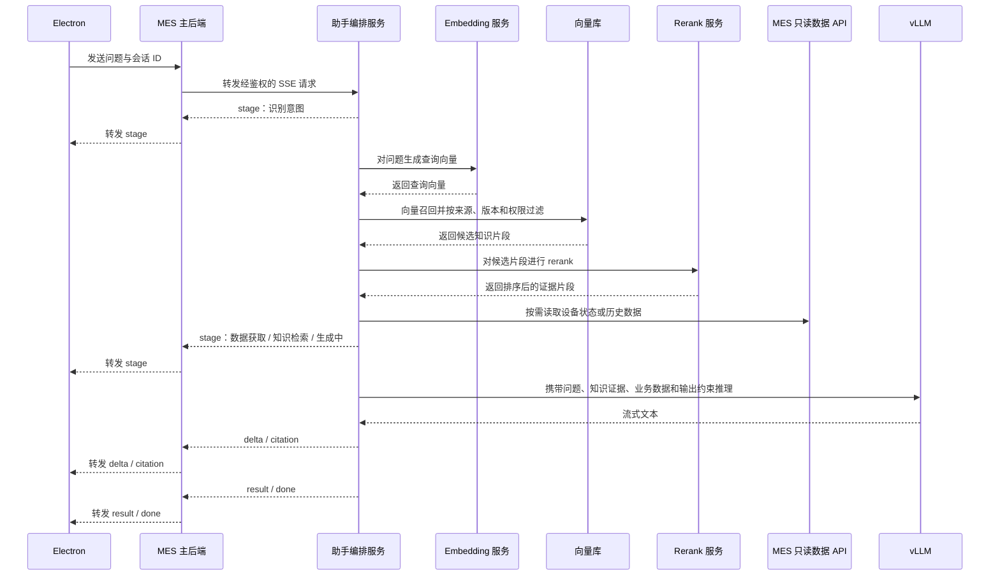
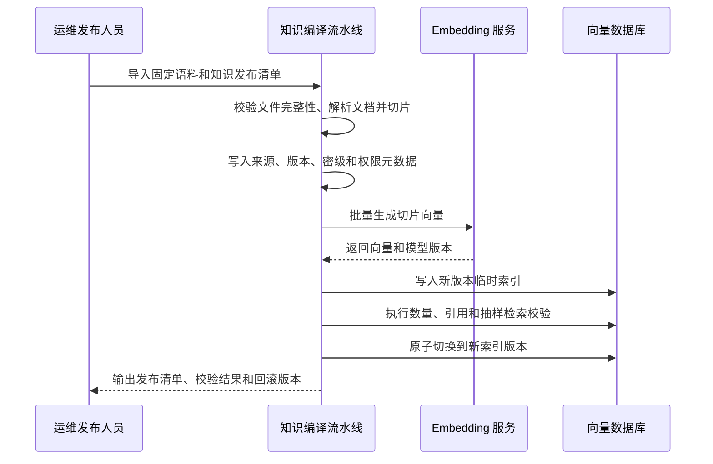

# 设备预测性维护与智能助手系统设计

> 文档状态：技术设计修订稿<br>
> 更新日期：2026-11-26<br>
> 适用对象：前端、后端、算法、系统集成、测试与部署人员

## 1. 设计目标与约束

本文定义设备预测性维护和智能助手的系统架构、接口、数据流、RAG 服务、部署和安全设计。业务目标、范围和验收标准见 [需求文档](./需求文档.md)。

### 1.1 当前 Go 主服务实现状态

当前 `main_server` 只实现健康检查、服务信息、请求日志与恢复、聊天 SSE 代理，不实现预测维护、
MQTT、业务数据库、自动建单、历史查询或其他主服务业务。本期设计在此基础上增加智能助手会话
管理接口代理，但仍不实现用户鉴权。

Go 服务使用单个运行时 JSON 配置，不读取环境变量或 `.env`。同一 ARM64 二进制可通过修改
`compute.base_url`、`compute.chat_path`、`compute.assistant_path`、监听地址和超时适配不同
A/B 机器；配置变化后重启服务生效，不重新编译。

本文其余预测维护、MQTT、数据库和工单内容属于后续目标设计，不代表当前 `main_server` 已实现。

本版新增“每日 24 小时事件化分析”目标：算力服按设备返回事件列表 `events[]`，一个连续异常
区间为一个事件，同一设备在一个 24 小时窗口内可以产生多个事件。当前算力服仍按请求返回单
设备分析结果，事件化契约见第 4.2 节，属于目标设计。

本版同时新增两项目标设计：主服务器先调用 `prepare` 启动全量预分析批次，算力服异步计算并
缓存事件，主服务器再逐设备调用命中缓存（见 3.1.2、4.5）；算力服 openGauss 保存每个事件的
最新人工审核与归档副本，主服务器仍是权威来源（见第 5 节）。

### 1.2 本期会话管理实现边界

本期仅接入会话管理，不扩展用户体系、反馈、工作流和报表能力。预测维护预分析批次、审核副本和缓存属于目标设计（见 3.1.2、4.5 和第 5 节），不在本期 Go 会话管理范围内。

- 前端和 Go 主服务不生成、不保存、不发送 `client_id` 或 `X-Client-Id`。
- Go 主服务在助手聊天和会话管理请求中不向算力服传递 `X-User-Id`、`X-User-Roles` 或
  `X-Client-Id`，避免后续账号切换或请求头变化导致会话空间变化。
- 算力服会话统一归属 `anonymous`。同一算力服实例和同一 openGauss 数据库下的历史为全局共享
  历史，管理员账号切换、重新登录、前端刷新或客户端重开不改变会话归属。
- 会话、消息和引用持久化到 openGauss。算力服或 Go 服务普通重启不会丢失历史；内存存储仅用于
  测试或无数据库演示。
- 本期 Go 主服务新增会话列表、创建、详情、重命名、删除和历史消息分页代理；消息反馈、工作流
  列表、报表列表、报表下载和浏览器会话认领不纳入本期。

核心约束：

- 既有 MES 主后端是唯一业务入口，负责用户鉴权、权限判断、审计和请求转发。
- 用户端与主服务器之间的鉴权、通信协议和接入页面由其他团队负责，本文不设计该部分。
- 数采软件只向主服务器关系数据库提供采集数据，不直接连接算力服。
- 主服务器关系数据库是采集数据、健康结果、维护工单、已发布 AI 结果、人工结论和评价的业务权威数据源。
- 主服务器通过独立 MQTT 发布任务持续向算力服同步指定近期数据；算力服时序库只保存该旁路分析数据。
- 主服务器在独立后台任务中定时调用算力服分析接口，校验返回字段后决定是否创建内部维护工单。本项目的“工单”指内部维护事件，不触发外部 MES 工单流转。
- 算力服负责预测分析、完整 RAG 服务和大模型推理，不直接连接主服务器数据库，不保存权威工单或已发布结果。算力服 openGauss 只保存主服务器推送的工单/审核副本和预分析缓存，不作为用户恢复来源或权威数据源。
- 算力服只通过结构化分析结果响应对主服务器提供旁路能力，并通过受控历史查询接口读取去标识化历史工单、已发布 AI 结果和人工审核结论。
- 算力服超时、故障、结果无效或 MQTT 同步中断不得阻塞主服务器用户请求、图表查询、工单处理和其他定时任务。
- 知识库采用固定、预先整理并经版本化发布的离线语料，不提供用户上传或在线管理接口。
- vLLM、embedding、rerank 和向量数据库只允许算力服内部访问。
- Qwen3-30B-A3B 首版采用与目标 CANN/vLLM-Ascend 版本匹配的 W8A8 量化版本；预测维护解释层允许使用经过压测的 Qwen3-14B 或等价模型。
- 预测维护风险等级、关键依据、数据限制和建议动作由算力服的确定性规则与动作库生成，模型只生成简短解释；解释模型失败时使用规则模板，不影响有效规则结果的返回。

## 2. 总体架构



### 2.1 网络与信任边界

1. Electron 和算力服位于同一局域网，但用户端只能访问 MES 主后端。
2. 用户认证和权限判断由主后端完成。用户接入和鉴权状态如需使用 MQTT，应使用独立控制主题，不得与维护数据主题混用；模型请求、响应和文件仍通过 HTTPS/SSE 代理。
3. 数采软件只向主服务器关系数据库供数，不得配置算力服数据库、内部 API 或 MQTT 订阅地址。
4. 主服务器使用独立发布任务和事务性待发送记录向 MQTT Broker 发布指定指标。发布失败、积压或重试不得占用主服务器业务请求线程。
5. 算力服使用持久订阅接收 MQTT 消息并幂等写入本地时序库。消息至少携带 `message_id`、`source_sequence`、设备、指标、值、单位、事件时间和质量标记。
6. 主服务器使用固定服务令牌在独立后台任务中调用算力服分析接口，设置连接超时、读取超时、并发上限和熔断。该任务不得占用用户请求线程。
7. 算力服只接受主服务器所在主机或受控网关的分析请求。算力服不得直接连接主服务器数据库，也不得回调修改工单。
8. 算力服通过主服务器历史查询接口读取去标识化历史工单、已发布 AI 结果和人工审核结论。查询接口只提供只读权限并限制时间跨度、条数和速率。
9. 算力服时序库只允许 MQTT 接收任务写入、本机分析服务读取，不作为用户查询入口；算力服 openGauss 只保存工单/审核副本和预分析缓存，不作为权威工单或已发布结果存储。
10. vLLM、embedding、rerank、MQTT 消费任务、时序库和向量数据库只监听算力服内部地址或受控 Broker 网络。
11. 固定知识语料通过受控制品通道进入算力服，用户端和主服务器不参与知识上传、切片或索引发布。

### 2.2 组件职责

| 组件 | 职责 |
| --- | --- |
| Electron | 展示待确认预测维护事件、综合判断、关键依据、建议动作和条件数据限制，提交“准确/需修正”人工审核结论并归档；不持有模型地址、数据库凭据或服务令牌 |
| 数采软件（外部） | 按约定频率只向主服务器关系数据库提供采集数据；本项目不实现采集链路 |
| MES 主后端 | 用户鉴权、权限校验、每日预分析 prepare 与批次轮询、结果校验、建单、图表查询、历史查询接口、审核权威存储和审计 |
| 主服务器关系数据库 | 保存采集数据、工单、已发布 AI 结果、人工审核结论和审计，是唯一业务权威来源 |
| MQTT 发布/订阅链路 | 主服务器持续发布指定指标，算力服持久订阅并写入近期时序库；消息使用 QoS 1 |
| FastAPI 内部 API | 输入校验、服务认证、同步分析、预分析批次与缓存、助手 SSE、错误映射和可观测性 |
| 预测性维护服务 | 校验本地 MQTT 数据水位、查询近期时序数据、回查历史工单、已发布结果与人工审核结论，执行数据质量、阈值、趋势、相关性和历史规则，按设备聚合事件，映射标准动作，调用模型生成简短解释，并返回结构化结果；支持提前预分析和缓存命中 |
| 算力服时序数据库 | 保存 MQTT 同步的近期分析数据，支持分析窗口查询、幂等去重、乱序处理和数据质量检查 |
| 智能助手编排 | 会话管理、查询向量化、知识召回、rerank、只读工具调用、上下文组装、引用整理和流式输出 |
| 知识编译流水线 | 消费固定语料和发布清单，执行解析、切片、元数据校验、embedding 和索引构建 |
| Embedding 服务 | 为查询和知识切片生成向量，仅提供算力服内部调用 |
| Rerank 服务 | 对向量召回候选按问题相关性重新排序，仅提供算力服内部调用 |
| vLLM | 为智能助手和预测维护解释层提供受控的 OpenAI 兼容推理接口，不直接面向用户端 |
| 对话关系数据库 | 保存助手会话、消息、引用、反馈和审计事件，以及主服务器推送的工单/审核副本和预分析缓存；不作为权威预测工单或已发布结果来源 |
| 向量库 | 保存知识切片、向量、元数据和可切换的索引版本 |
| 对象存储 | 保存固定知识语料、发布清单、分析报告、大型证据、模型产物和快照 |

### 2.3 预测性维护前端页面

本期预测性维护前端仅实现模拟展示页，不实现全站健康概览。页面直接展示待人工审核的事件列表，页面术语统一使用“事件”“新事件分析”和“已确认记录”，已确认记录列表标题使用“已确认事件记录”；后端内部的维护工单仍作为业务对象管理。页面结构以当前实现为基准：详情弹窗设计宽度为 1080px，最大宽度不超过视口，最大高度不超过 920px 与“视口高度减 40px”中的较小值；右侧人工审核栏和响应式布局保持现状。

页面要求：

- 默认进入“新事件分析”页签，展示待确认事件；已归档事件进入“已确认记录”页签，对应列表标题使用“已确认事件记录”。
- 筛选区提供结构化的站点筛选和设备类型筛选，可组合使用；关键词搜索作为附加检索能力。
- 事件列表一行一个事件，同一设备可以在列表中出现多行；每行展示站点、设备、事件类型、异常区间、健康等级和审核状态。
- 事件详情按单个事件展示：设备级 24 小时上下文曲线、高亮本次异常区间、事件区间曲线，以及上月同期/去年同期切换；历史时段无数据显示“无历史数据”，不按 0 处理。
- 同一设备的不同事件分别提交人工审核、分别归档。
- 设备类型固定为探测器和备电，两类事件彼此独立。探测器事件只携带 `detectorTrend`，详情只展示电离室剂量率和雨量；备电事件只携带 `backupTrend`，详情只展示当前电量、参考续航和历史参考。事件类型与趋势数据使用判别联合约束，不允许同一事件同时携带两类趋势数据。
- 前端 `detectorTrend` / `backupTrend` 由设备级 `context_series`、事件 `incident_series` 和 `comparisons` 映射：`current24h` 取 24 小时上下文，`lastMonth` / `lastYear` 取对应同期；事件区间由 `start` / `end` 高亮。
- 事件使用单一 `healthLevel` 字段，固定为 `insufficient_data`（数据不足）、`watch`（需关注）和 `inspect`（建议检修）三类，不另设 `analysisStatus` 字段，也不向页面发布 `normal` 状态。
- 每个事件的 AI 综合分析区域独立展示：顶部展示模型名称和生成时间；主体依次展示综合判断、最多 3 条关键依据、最多 3 条建议动作，并在存在数据问题时于底部展示一条数据限制提示。
- AI 区域不再展示“支持证据、数据缺口、后续复核、维护建议”四个并列卡片。“后续复核”合并为一条普通建议动作，“数据缺口”统一改为条件显示的数据限制；不展示置信度或模型精度。
- AI 区域不新增抽屉、Tab、折叠区或页面级操作栏，仍位于现有 `analysis-section--ai` 容器内，并保持现有 `analysis-workspace` 双栏结构。
- `insufficient_data` 不生成由维护规则或动作库派生的普通维护建议；若事件已由既有设备告警或其他权威业务事件触发，可在综合判断中保留告警状态保持和现场核查提示，作为事件处置说明，但不得扩展为新的建议动作。
- 用户对事件提交一次人工审核结论：`accurate` 表示 AI 结论准确，`needs_revision` 表示 AI 结论需修正；提交后事件进入 `confirmed` 归档状态。
- 人工审核结论记录包含 `outcome`、`comment`、`reviewed_at`、`reviewed_by` 和可选 `updated_at`，是唯一人工判断事实来源。
- 已确认记录列表中的“AI 评价 · 准确/需修正”标签由 `review.outcome` 派生，不再维护独立的 `aiFeedback` 对象，也不设置第二次评价操作。

## 3. 核心数据流

### 3.1 设备预测性维护

预测维护采用“主服务器定时调用、算力服旁路分析、主服务器校验建单”的链路。数采软件只向主服务器供数，算力服不从数采软件或主服务器数据库直接取数。主服务器、MQTT 和算力服之间形成单向数据增量与受控分析调用，任何旁路故障都不得影响主业务。

每个分析批次以站点本地时区的上一自然日（00:00–24:00）为窗口，逐站点、逐设备分析。算力服按设备返回事件列表：同一设备上一个连续异常区间为一个事件；时间重叠或间隔不超过合并阈值的多个规则依据合并为同一事件，不同异常区间分别成事件。



维护分析遵循“确定性规则决定结论与动作，模型只负责解释”的原则。数据质量、阈值、连续异常、趋势、相关性和历史上下文判断由可测试规则完成；风险等级、关键依据、数据限制和标准动作不依赖模型。模型只根据压缩后的规则事实为每个事件生成一段 `explanation`，不得修改风险等级、增加规则中不存在的数值、生成数据缺口或选择维护动作。

数据链路约束：

- 事件列表、事件图表和已发布结果只从主服务器关系数据库读取，不经过算力服。
- 数采软件不得直接连接算力服。算力服时序数据的唯一来源是主服务器发布到 MQTT 的指定指标。
- 主服务器定时器只负责调度，实际调用放在独立后台任务或任务队列中。调用必须设置连接超时、读取超时、并发上限、有限重试和熔断，不占用用户请求线程。
- 分析请求必须携带 `analysis_id`、站点、设备、分析类型、观察窗口、历史回查范围、`data_cutoff` 和 MQTT 数据水位。只约定起止时间不足以证明本地数据已追平。
- 算力服先检查 MQTT 消费水位，再查询本地时序库。本地水位未达到请求水位时，可在 `ANALYSIS_WATERMARK_WAIT_SECONDS` 内等待；超时返回明确错误，不得静默使用不完整窗口生成正式结论。
- 分析结果必须记录 MQTT 水位、`data_as_of`、数据时间范围、样本数量、缺失率、数据质量、规则集版本、动作库版本和解释来源。
- 同一 `analysis_id` 和 `Idempotency-Key` 的并发重复请求必须合并为一次分析执行，并在有限时间内返回同一结果；主服务器创建工单时按 `event_id` 执行幂等。
- 主服务器只接受符合 JSON Schema 的分析结果。字段无效、事件区间越界、健康等级越界或水位不足时，本轮记录失败和运维告警，不创建异常工单。
- 事件按 `event_id` 幂等：同一持续事件跨批次只更新已有工单和证据；不同异常区间即使属于同一设备、同一风险类型，也分别建单。抑制窗口（`WORK_ORDER_SUPPRESSION_HOURS`）只用于重复通知，不得合并不同事件。
- 算力服必须在配置的事件数上限内返回窗口内全部事件；`findings` 和 `actions` 的最多 3 条仅约束单个事件内的展示，不得用于截断事件。超出展示上限的依据通过 `analysis_id` 和 `event_id` 在结构化日志中追踪；超过事件数上限时合并相邻低等级事件并记录日志，不得静默丢弃。
- 数据质量按事件区间和设备窗口分别评估：单个事件区间内关键指标无数据或完整率低于配置门限时，该事件返回 `insufficient_data`，不得用模型常识、主服务器当前值或其他时间窗口补齐；该事件不调用解释模型，也不生成由维护规则或动作库派生的普通维护建议。24 小时窗口内局部缺数不得阻断其他区间的事件；只有整窗关键指标完全不可用时才生成设备级数据质量事件。辅助指标缺失只生成 `limitations`。
- 事件数据必须包含异常区间、设备级 24 小时上下文、事件区间曲线、上月同期和去年同期对比。曲线使用聚合桶；历史时段无数据时标记 `available=false` 并说明原因，不得按 0 处理。
- 规则分析成功后，仅解释模型超时或输出校验失败时，必须使用规则模板生成 `explanation` 并返回有效分析结果，不得因解释模型故障丢弃规则结论。
- 算力服不得保存工单或已发布结果。“工单”仅表示主服务器内部维护事件和人工审核状态，不自动执行设备操作、报警确认或外部 MES 工单流转。

#### 3.1.1 规则引擎与解释层

规则引擎位于算力服，负责根据分析窗口内的设备数据、指标配置、数据质量和历史上下文输出确定性结果。规则引擎不调用大模型，不使用模型常识补充缺失数据，每条结论必须能够追溯到规则编号、指标、观测值、时间窗口和数据来源。

规则至少分为以下层次：

| 层级 | 职责 | 主要输出 |
| --- | --- | --- |
| 数据质量 | 检查缺失、完整率、非法值、时钟偏差和样本数量 | `limitations` 或 `insufficient_data` 阻断原因 |
| 单指标阈值 | 检查预警限值、报警限值和连续越限次数 | `watch` 或 `inspect` finding |
| 趋势规则 | 检查持续上升、持续下降和短时跳变 | 趋势 finding |
| 相关性规则 | 检查剂量率与降雨、续航与负载、充电时间与历史基线等关系 | 原因候选 finding |
| 历史规则 | 查询同类事件重复情况、已发布结果和人工审核结论 | 历史上下文 finding 或附加动作 |

##### 事件化层

规则命中仍按连续区间输出，但对外以事件为单位。算力服在每个设备的 24 小时窗口内执行：

1. 将所有规则命中按 `start` 排序。
2. 时间重叠，或间隔不超过 `EVENT_MERGE_GAP_SECONDS`（建议取 `max(3 × 采样周期, 10 分钟)`，可配置）的命中合并为一个事件。
3. 仅用于上下文的命中（如 `HISTORY-REPEAT`）不单独成事件，只作为事件内证据。
4. 每个事件的 `severity` 取簇内最高值，`primary_code` 取最严重或最高优先级规则，`start` 和 `end` 取簇的边界。
5. 窗口开始前已异常标记 `open_at_start=true`；窗口结束时仍异常标记 `open_at_end=true`，下一批次按 `event_id` 续接。
6. `event_id = "<site_id>:<equipment_id>:<event_code>:<start_epoch_ms>"`，保证重复分析产生相同标识，并满足主服务器 `event_id` 的字符与长度约束；例如 `AS06-BAT-01:backup.mains_lost:1795404840000`。

每个 `finding` 使用统一结构，至少包含 `rule_id`、`code`、`severity`、`metric`、`observed`、`baseline`、`change_percent`、`window`、`message` 和 `source_refs`。每个事件内的 `findings` 保留全部依据用于追溯，前端最多展示 3 条；超出展示上限的依据通过包含 `analysis_id` 和 `event_id` 的结构化日志追踪。

健康等级按事件计算，设备级取最高事件等级；不设置独立的 `analysisStatus`：

1. 某个事件区间内关键指标无有效数据、完整率低于门限、数据过期或缺少必要判定配置时，该事件 `healthLevel=insufficient_data`。该质量闸门只作用于该事件，不阻断其他区间的事件。
2. 事件区间关键指标均可评估时，任一规则命中连续报警限值越限等检修条件，该事件 `healthLevel=inspect`。
3. 事件区间关键指标均可评估且无检修条件，但存在报警点、连续预警越限或其他关注条件时，该事件 `healthLevel=watch`。
4. 设备窗口内没有任何有效规则命中时，内部结果为 `normal`，不生成维护事件。
5. 设备级 `healthLevel` 按 `insufficient_data` > `inspect` > `watch` 的优先级取最高；仅当整窗关键指标完全不可用时，才生成设备级数据质量事件。辅助指标缺失只生成 `limitations`，不阻断关键指标继续判定。

`insufficient_data` 事件会进入待确认事件列表，用于提示补数或数据质量处置，但不生成内部检修工单，`actions` 必须为空数组。该事件人工核查完成或数据补齐并重新分析后，可以按 `event_id` 更新原事件；不同区间不得被合并。

前端不重新计算等级，只按下表展示单一字段：

| 后端结果 | 页面状态 | 后续处理 |
| --- | --- | --- |
| `healthLevel=insufficient_data` | 数据不足 | 展示事件，不生成检修工单 |
| `healthLevel=watch` | 需关注 | 生成内部工单，持续观察 |
| `healthLevel=inspect` | 建议检修 | 生成内部工单，安排现场核查 |
| 内部分析结果为 `normal` | 不生成事件 | 不展示 |

建议动作不交给模型自由生成。动作库按事件内 `finding.code`、设备类型和严重度映射标准动作，去重后每个事件最多 3 条，返回 `action_code`、`priority`、`text` 和 `requires_human_confirmation`。动作库和规则集都必须版本化；新增设备类型时优先增加规则和动作配置，不重新设计模型 Prompt 或前端结构。

模型只接收每个事件的压缩规则事实和标准动作，输出该事件的单个 `explanation` 字段。Prompt 应限制模型不生成新数值、设备、时间或来源，并关闭隐式思考。模型输出必须在 `MAINTENANCE_NARRATOR_MAX_CHARS` 长度范围内；结构校验失败、解释中引入未知数值、模型超时或不可用时，该事件统一使用规则模板并将 `explanation_source` 标记为 `template`，不影响其他事件。

#### 3.1.2 预分析批次与缓存

主服务器保持调度权：每天固定时间先调用 `POST /internal/v1/maintenance/analyses/prepare`，提交上一自然日窗口、`data_cutoff`、`mqtt_watermark` 和站点范围。算力服返回 `202 + batch_id`，在后台逐站点/设备完成规则、事件化、设备级 24 小时上下文、事件区间曲线、上月/去年同期和解释，写入批次缓存；主服务器轮询批次状态，就绪后逐设备调用 `POST /analyses`（带 `equipment_ids`），命中缓存直接返回。

缓存键至少包含：

```text
site_id + equipment_id + window_start + window_end +
data_cutoff + mqtt_watermark + rule_set_version +
action_catalog_version + narrator_prompt_version
```

规则：

- 只有窗口、水位和版本一致时才返回缓存；请求水位更高或版本不同时，缓存视为过期，重新分析或等待新批次。
- 预分析应等待数据稳定窗口（例如 00:05 后水位不再前进）再开始，并记录本批次的 `data_as_of` 和水位。
- 迟到数据允许按同一窗口、更高水位重算；事件按 `event_id` 更新，不重复创建。
- 预分析默认生成解释；解释模型失败时该事件使用模板解释，不阻塞整批。
- 缓存是非权威结果，主服务器仍负责校验、建单、发布和审核；缓存丢失或算力服重启时，主服务器可回退同步分析或重新 prepare。
- 批次状态应返回 `pending/running/ready/partial/failed`、设备数、事件数、错误摘要和水位；单设备失败不应使整批失败。
- 缓存设置 TTL 和容量上限；过期缓存不参与命中。

### 3.2 智能助手 RAG 链路



助手只拥有只读业务工具。事实性回答必须使用知识片段或业务数据，并附可定位引用；知识无命中、权限不足或数据不足时必须明确说明。

本期会话管理不启用用户级会话隔离。上述“经鉴权”和“权限过滤”描述的是后续 MES 用户鉴权接入后的
目标状态；本期 Go 服务不实现用户认证，会话管理固定使用全局 `anonymous` 会话空间。

### 3.3 知识编译与发布

知识文档在部署前完成收集和整理。每个发布版本由固定语料和清单构成，离线编译后作为只读知识包部署到算力服：



发布约束：

- 语料、清单和编译产物使用只读版本目录，不允许在运行时直接修改。
- 单次查询固定使用同一个 `KNOWLEDGE_INDEX_VERSION`，索引切换通过原子别名完成，不得混用新旧语料。
- 原始语料、切片元数据、embedding 模型版本、rerank 模型版本和构建时间必须可追溯。
- 知识无命中时不得编造引用；embedding、向量库或检索失败时返回明确错误或按配置降级并标注依据不足。
- 知识库不提供用户上传、删除、审核或索引管理接口。

## 4. 内部接口

以下接口是算力服与主后端之间的初始约定，路径统一使用 `/internal/v1` 前缀，最终以联调合同为准。Electron 不直接调用这些接口。

当前实现尚未采用 `/internal/v1/assistant/chat`。现有 Go 服务默认代理算力服
`/api/v1/chat`，该路径由 `compute.chat_path` 配置。本期 Go 主服务同时增加会话管理代理，
前端统一调用 `/api/v1/assistant/...`，由 Go 转发到算力服对应会话接口。

| 方法 | 路径 | 用途 |
| --- | --- | --- |
| `POST` | `/internal/v1/maintenance/analyses` | 主服务器调用算力服执行一次探测器、备电或通用维护分析，并同步返回最终结果 |
| `POST` | `/internal/v1/assistant/chat` | 创建或继续助手会话并流式返回内容 |
| `GET` | `/internal/v1/assistant/sessions` | 查询全局会话列表，支持 `limit`、`offset` |
| `POST` | `/internal/v1/assistant/sessions` | 显式创建会话 |
| `GET` | `/internal/v1/assistant/sessions/{session_id}` | 读取会话详情 |
| `PATCH` | `/internal/v1/assistant/sessions/{session_id}` | 重命名会话 |
| `DELETE` | `/internal/v1/assistant/sessions/{session_id}` | 软删除会话 |
| `GET` | `/internal/v1/assistant/sessions/{session_id}/messages` | 读取历史消息，支持 `limit`、`before_seq` |

预测维护事件列表、事件图表、内部工单和已发布结果由主服务器直接提供，算力服不暴露维护事件查询或分析任务状态接口。预测分析不使用 SSE；`/internal/v1/assistant/chat` 的 SSE 行为保持不变。

本期面向前端增加以下 Go 代理路径。代理只转发会话管理所需的请求，不提供通用反向代理：

| 方法 | Go 路径 | 算力服路径 |
| --- | --- | --- |
| `GET` | `/api/v1/assistant/sessions` | `/api/v1/sessions` |
| `POST` | `/api/v1/assistant/sessions` | `/api/v1/sessions` |
| `GET` | `/api/v1/assistant/sessions/{session_id}` | `/api/v1/sessions/{session_id}` |
| `PATCH` | `/api/v1/assistant/sessions/{session_id}` | `/api/v1/sessions/{session_id}` |
| `DELETE` | `/api/v1/assistant/sessions/{session_id}` | `/api/v1/sessions/{session_id}` |
| `GET` | `/api/v1/assistant/sessions/{session_id}/messages` | `/api/v1/sessions/{session_id}/messages` |

Go 代理必须保留 `limit`、`offset`、`before_seq` 查询参数，原样返回算力服 JSON 和 HTTP 状态码，
并在助手聊天及上述会话路由上主动移除 `X-User-Id`、`X-User-Roles` 和 `X-Client-Id`。服务级
`X-API-Key` 与 `X-Request-Id` 继续传递。

预测分析的时间序列数据通过 MQTT 进入算力服时序库。主服务器向算力服发起分析请求并同步接收最终结构化结果，不存在算力服结果回调或工单写回接口。

主后端必须为算力服提供受控历史查询接口：

| 方法 | 路径 | 用途 |
| --- | --- | --- |
| `GET` | `/internal/v1/maintenance/history` | 按站点、设备、时间范围和游标查询去标识化历史工单、已发布 AI 结果和人工审核结论 |

历史查询接口只接受算力服服务身份，使用独立只读令牌，不允许更新设备、工单、AI 结果或人工审核结论。接口必须限制时间跨度、返回条数和调用速率，返回内容不得包含用户身份、账号、角色或其他不必要的个人信息。

知识更新只通过受控离线制品发布，不新增用户上传、知识管理或索引操作接口。`/internal/v1/assistant/chat` 保持不变，检索、embedding、rerank 和 vLLM 调用均在算力服内部完成。

### 4.1 通用请求头

```http
Authorization: Bearer <COMPUTE_SERVICE_TOKEN>
X-User-Id: <user-id>
X-User-Roles: <role-a,role-b>
X-Request-Id: <uuid>
Idempotency-Key: <uuid>
traceparent: <w3c-trace-context>
```

- `Authorization` 用于验证调用方是已授权的主后端。
- 主服务器调用算力分析接口使用 `COMPUTE_SERVICE_TOKEN`；算力服调用主服务器历史查询接口使用独立的 `MES_SERVICE_TOKEN`。
- `X-User-Id` 和 `X-User-Roles` 属于后续 MES 用户鉴权接入后的目标能力，不是本期会话管理的输入。
  本期 Go 在助手聊天和会话管理路由上移除这些请求头，不使用 `X-Client-Id`，算力服统一使用
  `anonymous` 会话空间。上述身份头不得传给预测维护历史查询接口。
- `X-Request-Id` 贯穿主后端、算力服和模型调用日志。
- 维护分析调用必须支持 `Idempotency-Key`，历史查询使用只读服务令牌。

### 4.2 维护分析请求与结果

同步分析请求示例：

```json
{
  "analysis_id": "ma_01J...",
  "site_id": "AS01",
  "equipment_ids": ["AS01-DET-01"],
  "analysis_type": "detector",
  "observation_window": {
    "start": "2026-10-01T00:00:00+08:00",
    "end": "2026-10-12T23:59:59+08:00"
  },
  "history_lookback_days": 90,
  "data_cutoff": "2026-10-12T23:49:30.000Z",
  "mqtt_watermark": "18427"
}
```

`analysis_type` 初始支持 `detector`、`backup_power` 和 `general`。本版请求字段不变；`observation_window` 由主服务器按站点本地时区的上一自然日（00:00–24:00）传入，并携带 `data_cutoff` 和 `mqtt_watermark`。

`mqtt_watermark` 使用主服务器发布的单调递增来源序号或等价水位表示。算力服只有在本机 MQTT 消费水位达到该值后才允许进入正式分析；等待时间上限由 `ANALYSIS_WATERMARK_WAIT_SECONDS` 控制。

分析成功返回 `200 OK`。本版目标以事件为建单单位：结果以设备级 `events[]` 为主体，`health_level` 表示设备级汇总等级；顶层 `findings`、`actions`、`explanation` 和 `limitations` 可作为兼容字段返回，但主服务器必须使用 `events[]` 建单。`findings` 和 `actions` 的最多 3 条只约束单个事件内的展示，不约束事件数量。命中预分析缓存时，响应可额外带 `cache: {"hit": true, "batch_id": "..."}`（见 4.5）。

```json
{
  "analysis_id": "ma_01J...",
  "status": "completed",
  "site_id": "AS06",
  "equipment_id": "AS06-BAT-01",
  "analysis_type": "backup_power",
  "window": {
    "start": "2026-11-23T00:00:00+08:00",
    "end": "2026-11-24T00:00:00+08:00"
  },
  "health_level": "watch",
  "context_series": {
    "bucket_seconds": 300,
    "metrics": {
      "battery_voltage": [
        {"time": "2026-11-23T00:00:00+08:00", "avg": 12.15, "min": 12.1, "max": 12.2, "count": 5}
      ],
      "runtime_hours": [
        {"time": "2026-11-23T00:00:00+08:00", "value": 23.8}
      ]
    }
  },
  "events": [
    {
      "event_id": "AS06-BAT-01:backup.mains_lost:1795404840000",
      "site_id": "AS06",
      "equipment_id": "AS06-BAT-01",
      "event_type": "backup_power",
      "event_code": "backup.mains_lost",
      "title": "外部交流供电中断",
      "severity": "watch",
      "start": "2026-11-23T11:34:00+08:00",
      "end": "2026-11-23T16:33:00+08:00",
      "duration_minutes": 299,
      "open_at_start": false,
      "open_at_end": false,
      "findings": [
        {
          "rule_id": "BACKUP-RUNTIME-DROP",
          "code": "backup.runtime_drop",
          "severity": "watch",
          "metric": "runtime_hours",
          "observed": 18.0,
          "baseline": 23.66,
          "change_percent": -23.9,
          "window": "2026-11-23T00:00:00+08:00/2026-11-24T00:00:00+08:00",
          "message": "参考续航 18.0 小时，较基线 23.7 小时下降约 24%",
          "source_refs": ["ts:AS06:AS06-BAT-01:runtime_hours:11-23 00:00/11-24 00:00"]
        },
        {
          "rule_id": "BACKUP-ON-BATTERY",
          "code": "backup.mains_lost",
          "severity": "watch",
          "metric": "ac_power",
          "observed": 5.0,
          "window": "2026-11-23T11:34:00+08:00/2026-11-23T16:33:00+08:00",
          "message": "外部交流供电中断，已由蓄电池供电约 5.0 小时，当前电压 11.40 V",
          "source_refs": ["ts:AS06:AS06-BAT-01:ac_power:11-23 11:34/11-23 16:33"]
        }
      ],
      "actions": [
        {
          "action_code": "backup.check_charging_path",
          "priority": "primary",
          "text": "检查充电模块、接线和实际负载",
          "requires_human_confirmation": true
        },
        {
          "action_code": "backup.check_mains_supply",
          "priority": "secondary",
          "text": "核查外部交流供电恢复情况，评估剩余续航",
          "requires_human_confirmation": true
        }
      ],
      "limitations": [],
      "explanation": "外部交流供电中断约 5 小时，蓄电池放电至预警电压，续航较基线下降约 24%；建议优先检查充电链路并核查市电恢复情况。",
      "explanation_source": "model",
      "data_quality": {"completeness": 1.0, "missing_rate": 0.0},
      "incident_series": {
        "bucket_seconds": 60,
        "metrics": {
          "battery_voltage": [
            {"time": "2026-11-23T11:34:00+08:00", "value": 12.0}
          ]
        }
      },
      "comparisons": {
        "last_month": {
          "available": true,
          "window": {"start": "2026-10-23T11:34:00+08:00", "end": "2026-10-23T16:33:00+08:00"},
          "avg": 12.1,
          "min": 12.0,
          "max": 12.2,
          "change_percent": -5.8
        },
        "last_year": {
          "available": false,
          "reason": "no_history"
        }
      }
    }
  ],
  "data_snapshot": {
    "mqtt_watermark": "18427",
    "window": {
      "start": "2026-11-23T00:00:00+08:00",
      "end": "2026-11-24T00:00:00+08:00"
    },
    "data_as_of": "2026-11-23T23:59:30+08:00",
    "sample_count": 2882,
    "completeness": 1.0,
    "missing_rate": 0.0
  },
  "versions": {
    "rule_set": "maintenance-rules-2026.11.1",
    "action_catalog": "maintenance-actions-2026.11.1",
    "prompt": "maintenance-narrator-v1",
    "model": {
      "name": "Qwen3-14B",
      "precision": "以模型清单为准",
      "revision": "以模型清单为准"
    }
  },
  "generated_at": "2026-11-24T00:05:00+08:00"
}
```

示例省略顶层的兼容汇总字段和 `findings`/`actions`；实际响应可按兼容策略返回。

事件字段说明：

- `event_id`：由站点、设备、主规则代码和事件开始时间（epoch 毫秒）确定，格式为 `<site_id>:<equipment_id>:<event_code>:<start_epoch_ms>`，重复分析必须产生相同标识；主服务器按此幂等更新。总长度不得超过主服务器 `event_id` 的 64 字符限制，超长时对时间部分使用稳定哈希后缀。
- `event_type`：`detector`、`backup_power` 或 `data_quality`。
- `event_code`：事件的主规则代码；事件内全部依据放在 `findings[]`。
- `severity`：`watch`、`inspect` 或 `insufficient_data`；同一事件取簇内最高值。
- `start` / `end` / `duration_minutes`：事件异常区间；`open_at_start` / `open_at_end` 表示窗口边界仍未恢复。
- `findings[]`：事件内全部规则依据；前端最多展示 3 条。
- `actions[]`：按事件内依据映射、去重后最多 3 条，第一条为 `primary`。
- `limitations[]`：该事件的数据限制，最多 1 条。
- `explanation` / `explanation_source`：该事件独立的解释和来源。
- `data_quality`：按该事件区间计算的完整率和缺失率。
- `incident_series`：事件区间曲线，桶粒度可高于 24 小时上下文。
- `comparisons.last_month` / `last_year`：事件区间按日历平移后的同期统计；`available=false` 时必须给出 `reason`，不得按 0 处理。
- `context_series`：每设备一份 24 小时上下文，按 `bucket_seconds` 聚合，不随事件数量重复返回。

事件化规则：

1. 规则命中仍按连续区间输出；时间重叠或间隔不超过 `EVENT_MERGE_GAP_SECONDS` 的命中合并为同一事件。
2. 仅用于上下文的命中（如 `HISTORY-REPEAT`）不单独成事件，只作为事件内证据。
3. 窗口结束时仍异常的事件标记 `open_at_end=true`，下一批次按 `event_id` 续接。
4. 同一设备窗口内可以返回多个事件；不同事件分别返回、分别建单。
5. 数据质量按事件区间评估：局部缺数只影响该事件；整窗关键指标完全不可用时返回 `event_type=data_quality` 的事件，`actions` 为空。
6. 设备窗口内没有有效规则命中时不返回事件，设备级 `health_level=normal`。
7. 事件曲线和同期查询受配置的点数上限约束；历史缺失时返回 `available=false`，不得用 0 或空数组冒充历史数据。
8. `analysis_type=general` 时，一个响应可以包含同一站点多个设备的事件；每个事件必须带 `equipment_id`。主服务器按 `equipment_id + event_id` 建单，也可以按设备分别调用 `detector` 或 `backup_power` 分析。
9. 跨批次续接以主服务器已存事件为准：`open_at_start=true` 时，算力服返回的 `start` 可能被窗口起点截断；主服务器应按同设备、同 `event_type` 查找未关闭事件并沿用原 `event_id`，不要仅凭新 `event_id` 另建事件。

成功响应使用 `status=completed`。事件级 `health_level` 使用 `watch`、`inspect`、`insufficient_data`；`explanation_source` 使用 `model` 或 `template`；`findings[].severity` 使用 `watch` 或 `inspect`；`actions[].priority` 使用 `primary` 或 `secondary`。

事件内 `findings` 由规则引擎生成，不由模型补写；`actions` 由版本化动作库按规则代码生成；`limitations` 只在实际存在数据问题时返回，最多 1 条。模型只返回该事件的 `explanation`；模型超时、不可用或输出校验失败时，该事件使用规则模板并返回 `explanation_source=template`，不因此丢弃有效规则结果，也不影响其他事件。

当某事件 `severity=insufficient_data` 时，该事件 `findings` 可以为空，`actions` 必须为空数组，`limitations` 至少包含 1 条数据限制，`explanation` 使用模板生成且 `explanation_source=template`。当某事件 `severity=watch` 或 `inspect` 时，该事件 `findings` 和 `actions` 各至少返回 1 条；`actions` 的第一条必须是 `priority=primary`。

水位不足、时序数据不可用、规则引擎异常或最终结果结构无效时，通过明确的 HTTP 错误码和脱敏错误体返回。已废弃的 `risk_summary`、`evidence`、`recommendations`、`data_gaps`、`confidence` 和独立 `follow_up` 字段不得继续出现在新接口响应中。

算力服内部接口统一使用 snake_case。主服务器面向前端发布结果时显式映射为 camelCase，例如 `health_level` 映射为 `healthLevel`、`explanation_source` 映射为 `explanationSource`、`change_percent` 映射为 `changePercent`、`requires_human_confirmation` 映射为 `requiresHumanConfirmation`。前端不得直接依赖算力服内部接口字段。

### 4.3 助手 SSE 事件

预测维护不使用 SSE。以下事件仅用于智能助手；助手 SSE 仍由主服务器代理，连接中断后按会话 ID 恢复。

| 事件 | 内容 |
| --- | --- |
| `stage` | 当前阶段、用户可见说明和进度 |
| `delta` | 助手文本增量 |
| `citation` | 数据或知识来源、片段标识和链接信息 |
| `result` | 助手的结构化最终结果 |
| `error` | 错误码、可重试标记和脱敏说明 |
| `done` | 本次流结束标记 |

每个事件包含单调递增的 `seq`。服务端定期发送 SSE 注释行作为心跳；连接中断后通过会话 ID 恢复。维护分析水位不足、规则执行失败和最终结果无效不通过用户可见 SSE 表达，只记录主服务器运维告警和调用日志；解释模型失败通过模板解释降级，不产生用户可见错误。

### 4.4 会话归属与持久化

本期会话管理不引入用户或浏览器身份。前端不生成 `client_id`，Go 主服务不向算力服传递用户或
浏览器身份头。算力服将全部会话写入固定的 `anonymous` 会话空间，因此同一算力服实例下的账号
切换、重新登录、页面刷新和客户端重开均不会产生新的历史空间。

会话数据按以下规则持久化：

- 配置 `OPENGAUSS_DSN` 时，会话写入 `chat_session`，消息写入 `chat_message`，引用随助手消息保存。
- openGauss 数据和持久化卷正常时，算力服或 Go 服务重启不清空历史。
- 未配置 `OPENGAUSS_DSN` 时仅使用内存存储，适用于测试或无数据库演示，不在生产部署中启用。
- 删除会话采用软删除；历史消息通过 `seq` 和 `before_seq` 向前分页。
- 本期不提供消息反馈、工作流列表、报表列表、报表下载和浏览器会话认领接口。

### 4.5 维护预分析批次与审核副本

预分析批次接口（主服务器 → 算力服，服务令牌）：

| 方法 | 路径 | 用途 |
| --- | --- | --- |
| `POST` | `/internal/v1/maintenance/analyses/prepare` | 启动上一自然日全量预分析，返回 `202 + batch_id` |
| `GET` | `/internal/v1/maintenance/analyses/batches/{batch_id}` | 查询批次状态、水位、设备数、事件数和错误摘要 |
| `POST` | `/internal/v1/maintenance/analyses` | 逐设备取结果（带 `equipment_ids`）；缓存命中时快速返回，未命中时同步分析或返回明确错误 |
| `PUT` | `/internal/v1/maintenance/work-orders/{event_id}/review` | 保存/覆盖某事件的最新人工审核与归档结论（副本） |

`prepare` 请求示例：

```json
{
  "batch_id": "pb_01J...",
  "window": {
    "start": "2026-11-23T00:00:00+08:00",
    "end": "2026-11-24T00:00:00+08:00"
  },
  "site_ids": ["AS01", "AS02"],
  "data_cutoff": "2026-11-23T23:59:30+08:00",
  "mqtt_watermark": "1795491240000",
  "include_explanations": true
}
```

- `site_ids` 为空表示全部站点；`include_explanations` 默认 `true`，本版按全量预生成执行，设为 `false` 仅用于降级或调试。
- `batch_id` 可由主服务器生成，也可省略由算力服生成；一旦返回，后续状态查询和缓存命中都使用该值。
- 同一 `batch_id` 幂等；重复 `prepare` 返回同一批次，或按主服务器约定返回 `409`。

批次状态响应示例：

```json
{
  "batch_id": "pb_01J...",
  "status": "ready",
  "window": {
    "start": "2026-11-23T00:00:00+08:00",
    "end": "2026-11-24T00:00:00+08:00"
  },
  "data_cutoff": "2026-11-23T23:59:30+08:00",
  "mqtt_watermark": "1795491240000",
  "device_count": 36,
  "event_count": 12,
  "failed_devices": [],
  "started_at": "2026-11-24T00:05:00+08:00",
  "finished_at": "2026-11-24T00:08:30+08:00"
}
```

- `status` 使用 `pending`、`running`、`ready`、`partial`、`failed`。`partial` 表示部分设备失败，主服务器可读取成功设备并回退失败设备。
- 逐设备分析先按缓存键匹配 `prepare` 批次；命中时返回缓存结果并带 `cache: {"hit": true, "batch_id": "..."}`。未命中时按现有同步分析执行，或由主服务器选择等待/重试；不得返回与请求窗口、水位或版本不一致的缓存。
- 缓存命中不改变 `analysis_id` / 幂等语义；主服务器仍按 `event_id` 建单。

审核副本：

- 事件和 AI 结果继续通过 `PUT /internal/v1/maintenance/work-orders/{event_id}` 同步。
- 审核提交和修改通过 `PUT /internal/v1/maintenance/work-orders/{event_id}/review` 同步，只更新 `review` 和 `status`，不要求主服务器重传整个工单。

请求示例：

```json
{
  "outcome": "accurate",
  "comment": "已现场核查，AI 结论与实际情况一致",
  "reviewed_at": "2026-11-26T10:00:00+08:00",
  "updated_at": "2026-11-26T10:00:00+08:00",
  "archived_at": "2026-11-26T10:00:00+08:00"
}
```

规则：

- `outcome` 必填，取 `accurate` 或 `needs_revision`；`comment` 可选，最多 2000 字符。
- `reviewed_at`、`updated_at`、`archived_at` 可省略，省略时使用当前时间；如提供必须带时区。
- 事件必须已存在于 `maintenance_work_order` 副本，否则返回 `404 work_order_not_found`。
- `updated_at` 早于副本当前 `source_updated_at` 时返回 `409 stale_review`；相同或更新时覆盖。
- 成功后 `review` 只保留最新一份，`status=confirmed`，`source_updated_at=updated_at`，`received_at=now`。
- `archived_at` 在首次归档时默认取 `reviewed_at`；后续修改未提供时保留原值。
- 不保留审核修改历史，不接收、不存储审核人身份。
- 响应返回更新后的 `WorkOrder` 副本，与 `GET /work-orders/{event_id}` 结构一致。

## 5. 数据与存储设计

| 数据类别 | 存储 | 说明 |
| --- | --- | --- |
| 采集数据、事件、工单与已发布结果 | 主服务器关系数据库 | 采集数据、事件、健康概览、工单、AI 结果、事件曲线快照或曲线引用、人工审核结论和审计的业务权威来源 |
| 算力服分析时序数据 | 算力服时序数据库 | 主服务器通过 MQTT 持续同步的指定近期数据；MQTT 接收任务写入，分析服务只读；保留策略需覆盖上月/去年同期查询 |
| 助手会话、引用、工单/审核副本与预分析缓存 | 算力服 openGauss 对话关系数据库 | 保存全局 `anonymous` 会话、消息和引用；保存主服务器推送的工单副本（含最新人工审核/归档，不保留审核历史，不存审核人身份）；保存预分析批次与事件缓存（非权威，可 TTL 清理） |
| 固定知识语料与发布清单 | 对象存储 | 只读语料包、校验和、解析结果索引和版本记录 |
| 知识切片与向量 | 向量库 | 分片、向量、来源、密级、权限和索引版本元数据 |
| 报告与大型证据 | 对象存储 | Excel、PDF、原始证据快照和模型产物索引 |

预测维护的事件、工单、已发布结果、事件曲线快照或曲线引用和人工审核结论以主服务器关系数据库为权威来源。算力服 openGauss 保存主服务器推送的工单/审核副本和预分析批次缓存，用于助手查询、历史回查和降低主服务器调用延迟；这些副本和缓存不作为事件、工单或用户状态的恢复来源。

`maintenance_work_order.review` 只保留最新一份审核/归档记录，字段为 `outcome`、`comment`、`reviewed_at`、`updated_at`、`archived_at`；由 `PUT /internal/v1/maintenance/work-orders/{event_id}/review` 写入，审核修改覆盖原记录，不保留历史版本；审核人身份不进入副本。

预分析缓存建议使用两张表，按 `batch_id` 和 `event_id` 关联：

- `maintenance_analysis_batch`：批次、窗口、`data_cutoff`、`mqtt_watermark`、规则/动作/提示词版本、状态、设备数、事件数、起止时间和错误摘要。
- `maintenance_event_cache`：预分析事件（`event_id`、`batch_id`、站点、设备、事件类型、严重度、区间和事件 JSON）。

缓存设置 TTL 和容量上限，过期或版本不一致的缓存不参与命中；主服务器建单前必须重新校验事件和 `event_id`。

算力服时序库的保留策略必须覆盖上月同期和去年同期查询，建议不少于 13 个月。日历月平移（如 1 月 31 日、2 月 29 日）按站点本地时区处理；无法对齐时向前取最近有效日，并在 `comparisons` 中标记实际查询窗口。保留期不足或历史缺失时返回 `available=false` 和原因，不得按 0 处理。

本次会话管理的会话历史以算力服 openGauss 为准。所有接入前端共享同一算力服实例下的全局会话
空间；该设计不提供用户级隐私隔离或权限控制，访问范围由固定工作站和受控网络边界决定。

建议通过兼容性测试锁定以下产品版本：

- 主服务器关系库：以现场主服务器实际产品为准，至少支持事务、唯一约束、游标分页和只读查询账号。
- 算力服对话关系库：openGauss、Kingbase 等兼容 PostgreSQL 的国产数据库。
- 算力服时序库：支持 ARM64 离线部署、批量写入、时间窗口查询和保留策略的国产时序数据库。
- 向量库：支持 ARM64 离线部署的国产向量数据库。
- 对象存储：支持 S3 兼容接口、可离线部署的国产对象存储。

知识切片必须保存来源、版本、生效日期、密级和权限范围。发布清单至少记录语料版本、解析器版本、切片策略版本、embedding 模型版本、rerank 模型版本、向量维度、构建时间和校验和。

MQTT 同步与分析一致性规则：

1. 主服务器和算力服使用同一消息契约，至少统一设备编码、指标编码、单位、时区、采样频率、`message_id`、`source_sequence` 和 `schema_version`。
2. 主服务器使用独立后台发布任务读取指定的待同步指标，并通过事务性待发送记录保证数据库提交与 MQTT 发布可追踪。MQTT 不可用不得阻塞主数据库事务。
3. MQTT 主题使用 `maintenance/v1/{site_id}/{equipment_id}/telemetry`，消息使用 QoS 1、非 retained 和持久订阅。生产环境启用认证与 TLS。
4. 同一 `message_id` 或 `source_sequence` 重复到达时按幂等处理。晚到和补数数据必须保留原事件时间，并更新对应分析和质量信息。
5. 主服务器分析调度产生的 `mqtt_watermark` 是本次分析的触发依据。算力服必须先追平该水位，再查询本地时序库。
6. 分析结果保存 `mqtt_watermark`、`data_as_of`、查询范围、样本数量、缺失率和数据质量；不得只保存分析开始时间。
7. 主服务器和算力服应分别监控 MQTT 发布水位、消费水位、积压数量和延迟。长时间偏差需要告警，并阻止基于过期数据生成新的正式结论。
8. 主服务器关系数据库保存用户可见的工单、已发布结果、人工审核结论和审计；算力服只保存工单/审核副本和预分析缓存，不作为用户恢复来源。

主服务器历史查询接口返回以下去标识化信息：

- 历史事件标识、站点、设备、风险类型、事件类型、事件区间（起止时间）、健康等级和触发时间。
- 已发布 AI 结果中的综合判断、关键依据、建议动作、数据限制、解释来源、规则集/动作库/Prompt/模型版本和数据时间。
- 单一人工审核结论，包括“准确/需修正”、审核说明和审核时间。

查询接口不得返回用户 ID、账号、角色或完整会话内容。人工审核结论仅作为本次分析上下文和统计依据，不作为在线训练数据。

历史查询请求示例：

```http
GET /internal/v1/maintenance/history?site_id=AS01&equipment_id=AS01-ROOM-01&from=2026-07-01T00:00:00%2B08:00&to=2026-10-12T23:59:59%2B08:00&limit=50
Authorization: Bearer <MES_SERVICE_TOKEN>
X-Request-Id: <uuid>
```

最小响应示例：

```json
{
  "items": [
    {
      "event_id": "AS01-DET-01:detector.rainfall_correlated_rise:1787011200000",
      "site_id": "AS01",
      "equipment_id": "AS01-DET-01",
      "risk_type": "detector",
      "event_type": "detector",
      "event_code": "detector.rainfall_correlated_rise",
      "health_level": "watch",
      "event_start": "2026-08-18T08:00:00+08:00",
      "event_end": "2026-08-18T10:00:00+08:00",
      "triggered_at": "2026-08-18T10:00:00+08:00",
      "ai_result": {
        "explanation": "剂量率升高时段与降雨峰值重合，现有依据更支持先核查环境因素。",
        "explanation_source": "model",
        "findings": [
          {
            "rule_id": "DETECTOR-RAIN-CORRELATION",
            "code": "detector.rainfall_correlated_rise",
            "severity": "watch",
            "metric": "dose_rate",
            "observed": 0.079,
            "baseline": 0.061,
            "change_percent": 29.5,
            "window": "2026-08-17T10:00:00+08:00/2026-08-18T10:00:00+08:00",
            "message": "剂量率升高时段与降雨峰值重合",
            "source_refs": ["ts:AS01-DET-01:dose_rate:2026-08-18"]
          }
        ],
        "actions": [
          {
            "action_code": "detector.verify_rainfall_context",
            "priority": "primary",
            "text": "核对同期降雨、环境温湿度和周边作业记录",
            "requires_human_confirmation": true
          }
        ],
        "limitations": [],
        "versions": {
          "rule_set": "maintenance-rules-2026.11.1",
          "action_catalog": "maintenance-actions-2026.11.1",
          "prompt": "maintenance-narrator-v1",
          "model": {
            "name": "Qwen3-14B",
            "precision": "以模型清单为准",
            "revision": "以模型清单为准"
          }
        },
        "data_as_of": "2026-08-18T09:59:30+08:00"
      },
      "review": {
        "outcome": "accurate",
        "comment": "已安排现场核查，风险判断与现场情况一致",
        "reviewed_at": "2026-08-18T12:00:00+08:00",
        "archived_at": "2026-08-18T12:00:00+08:00"
      }
    }
  ],
  "next_cursor": null
}
```

## 6. 目标环境与部署设计

### 6.1 目标硬件

| 项目 | 配置 |
| --- | --- |
| CPU | 鲲鹏 920-Smart，32 核 |
| 内存 | 128 GB DDR4 2933 |
| 本地存储 | 4 TB M.2 |
| 推理加速 | 昇腾 Atlas 300I A2 64 GB × 1 |
| 电源 | 1250 W ATX |
| 模型 | Qwen3-30B-A3B W8A8（目标模型）；预测维护解释层可使用 Qwen3-14B 或等价模型 |
| Embedding / Rerank | 位于算力服内部，使用 CPU 或 NPU 由压测决定 |
| 应用服务 | Python + FastAPI，ARM64 容器镜像 |
| 容器 | Docker/containerd，生产环境优先离线镜像 |

Qwen3-30B-A3B 约 305 亿参数，BF16 权重约 61 GB，无法在单张 64 GB 卡上为 KV Cache、运行时和并发预留足够空间。首版按 W8A8 验证；如果单卡无法满足指标，依次优化上下文和缓存参数、增加第二张卡，或改用较小模型。预测维护只要求模型生成简短解释，允许在压测通过后使用 Qwen3-14B 或等价模型作为解释层；模型选择必须写入分析结果版本信息。

### 6.2 部署边界

```text
数采软件
  └─ 只写入主服务器关系数据库

主服务器关系数据库
  └─ 独立 MQTT 发布任务 → MQTT Broker → 算力服时序数据库

主后端所在网段
  ├─ 仅允许访问算力服 FastAPI 的 443/指定内部端口
  └─ 向算力服开放只读历史查询接口和服务令牌

算力服主机
  ├─ FastAPI 内部 API
  ├─ MQTT 持久订阅任务
  ├─ 时序数据库（接收任务可写，分析服务只读）
  ├─ 固定知识语料 / 知识编译产物
  ├─ Embedding / Rerank 内部服务
  ├─ 关系库 / 向量库 / 对象存储
  └─ vLLM（仅本机或内部容器网络）

用户电脑
  └─ 只访问既有 MES 主后端
```

FastAPI 不把任意用户输入直接转发给 vLLM；请求经过长度限制、权限校验、敏感信息处理和并发控制。vLLM、embedding、rerank、MQTT 消费任务、时序库和向量数据库不配置公网监听。

算力服旁路隔离要求：

- 主服务器分析调度使用独立后台任务或任务队列，限制并发数和单次超时，并配置熔断。
- 算力服不可用时，本轮任务直接结束并告警，不进行无界重试，不创建异常工单。
- MQTT 发布与主服务器业务请求线程分离，Broker 不可用只影响后续同步和算力分析时效。
- 算力服只能通过受控历史查询接口读取主服务器数据，不能直接连接主服务器数据库。
- 主服务器用户请求、图表查询、工单处理和既有定时任务不依赖算力服可用性。

### 6.3 发布流程

1. 在 ARM64 目标架构构建 Electron 安装包、FastAPI 镜像和部署组件。
2. 从受控制品库拉取锁定版本的基础镜像、CANN、vLLM 适配组件、Python 依赖和模型。
3. 导出离线包，并为镜像、模型、embedding/rerank 模型、配置和固定知识语料生成 SHA-256 清单。
4. 在隔离网络导入制品，完成数据库、对象存储和知识语料迁移。
5. 执行知识解析、切片、embedding 和索引构建，对临时索引执行数量、元数据、引用和抽样检索校验。
6. 校验通过后原子切换 `KNOWLEDGE_INDEX_VERSION`。
7. 启动服务并执行 LLM、embedding、rerank、RAG、内部 API 和主后端联调检查。
8. 灰度开放功能；故障时切回上一版本镜像、模型、RAG 配置和索引。

具体 `docker run`、`vllm serve` 和 CANN 安装命令应在硬件、驱动和镜像版本确认并通过压测后写入独立部署手册。

## 7. 工程结构与配置

### 7.1 建议工程结构

```text
.
├─ electron/                    # 客户端维护、助手页面
├─ compute-service/
│  ├─ app/
│  │  ├─ api/internal/v1/       # 分析接口与助手 SSE
│  │  ├─ maintenance/           # 规则引擎、动作库、解释与结果编排
│  │  │  ├─ rules/              # 质量、阈值、趋势、相关性和历史规则
│  │  │  ├─ actions/            # 规则代码到标准动作的版本化映射
│  │  │  ├─ narrator/           # 模型解释、模板回退和输出校验
│  │  │  └─ schemas/            # 分析请求、finding、action 和响应模型
│  │  ├─ assistant/             # 检索、rerank、上下文组装、工具调用和引用
│  │  ├─ knowledge/             # 固定语料解析、切片、向量化和索引发布
│  │  ├─ integrations/          # MQTT 消费、时序库、MES 历史 API、vLLM、embedding 和 rerank 适配
│  │  ├─ persistence/           # 关系库、向量库、对象存储和知识发布清单
│  │  └─ core/                  # 配置、鉴权、日志和错误模型
│  └─ tests/
├─ deploy/
│  ├─ containers/               # ARM64 镜像定义
│  ├─ compose/                  # 局域网部署编排
│  └─ manifests/                # 版本、模型和知识清单
└─ docs/                        # 接口、部署、压测和 RAG 运维文档
```

当前 Go `main_server` 按最小业务范围实现为 4 个生产文件和 2 个测试文件：

```text
main_server/
├─ main.go
├─ config.go
├─ api.go
├─ assistant.go
├─ api_test.go
├─ assistant_test.go
└─ config.example.json
```

- `main.go` 负责配置路径参数、启动、关闭和日志。
- `config.go` 负责 JSON 加载、默认值和启动校验。
- `api.go` 负责现有路由、响应、请求 ID、访问日志和 panic 恢复。
- `assistant.go` 负责聊天请求校验、算力服调用、错误映射和 SSE 转发。

### 7.2 环境配置

当前 Go `main_server` 不使用下列环境变量，而是使用运行时 JSON 配置：

```json
{
  "listen_addr": "127.0.0.1:8080",
  "environment": "development",
  "log_level": "info",
  "shutdown_timeout": "10s",
  "compute": {
    "base_url": "http://172.16.103.196:8000",
    "chat_path": "/api/v1/chat",
    "assistant_path": "/api/v1",
    "timeout": "3m",
    "api_key": ""
  }
}
```

`compute.base_url` 必须显式提供；`chat_path` 默认 `/api/v1/chat`；`assistant_path` 默认由
`chat_path` 的父路径推导，例如 `/api/v1/chat` 推导为 `/api/v1`；`api_key` 可为空。配置
文件拒绝未知字段，非法 URL、路径、超时和日志级别会使服务启动失败。生产环境使用
`-config /etc/mes/main-server.json`，不读取环境变量覆盖值。

下列变量是后续整体设计的环境配置约定，不代表当前 Go 主服务已支持：

| 变量 | 用途 |
| --- | --- |
| `MES_API_BASE_URL` | MES 主后端历史查询和只读业务接口地址 |
| `COMPUTE_SERVICE_TOKEN` | 主后端调用算力服的服务令牌 |
| `MES_SERVICE_TOKEN` | 算力服调用 MES 历史查询和只读业务工具的只读凭据 |
| `MAINTENANCE_ANALYSIS_TIMEOUT_SECONDS` | 主服务器调用算力分析接口的读取超时 |
| `MAINTENANCE_ANALYSIS_MAX_CONCURRENCY` | 主服务器允许同时执行的分析调用数 |
| `WORK_ORDER_SUPPRESSION_HOURS` | 重复通知抑制窗口，默认 24 小时；只抑制重复推送，不合并不同事件 |
| `EVENT_MERGE_GAP_SECONDS` | 同一设备相邻规则命中的事件合并阈值，建议取 `max(3 × 采样周期, 600)` |
| `MAINTENANCE_EVENT_MAX_PER_DEVICE` | 每设备每批次最大事件数，超出时合并相邻低等级事件或记录截断日志 |
| `MAINTENANCE_SERIES_BUCKET_SECONDS` | 24 小时上下文曲线的默认聚合桶，建议不小于 300 秒 |
| `MAINTENANCE_SERIES_MAX_POINTS` | 单指标单时段曲线点数上限 |
| `MAINTENANCE_PRECOMPUTE_TIME` | 预分析批次的建议执行时刻，默认 `00:05`（站点本地时区） |
| `MAINTENANCE_PRECOMPUTE_STABILITY_SECONDS` | 预分析前等待水位稳定的时间，默认 300 秒 |
| `MAINTENANCE_PRECOMPUTE_CONCURRENCY` | 预分析逐设备并发数 |
| `MAINTENANCE_PRECOMPUTE_TIMEOUT_SECONDS` | 单个设备预分析超时 |
| `MAINTENANCE_PRECOMPUTE_EXPLANATIONS` | 是否在预分析阶段生成模型解释，默认 `true`；失败回退模板 |
| `MAINTENANCE_CACHE_TTL_HOURS` | 预分析缓存保留时间，默认 48 小时 |
| `MAINTENANCE_CACHE_MAX_BATCHES` | 预分析缓存最大批次数，超出按最旧批次清理 |
| `MQTT_BROKER_URL` | MQTT Broker 地址 |
| `MQTT_CLIENT_ID` | 算力服持久订阅客户端标识 |
| `MQTT_TOPICS` | 允许订阅的维护数据主题 |
| `MQTT_QOS` | 维护数据订阅 QoS，默认 1 |
| `MQTT_TLS_*` | MQTT TLS、CA 和客户端证书配置 |
| `LOCAL_TSDB_DSN` | 算力服时序库分析连接串，必须使用只读分析账号 |
| `LOCAL_TSDB_WRITE_DSN` | MQTT 接收任务使用的独立写入账号 |
| `ANALYSIS_WATERMARK_WAIT_SECONDS` | 等待本地 MQTT 消费水位追平请求水位的最大时间 |
| `ANALYSIS_WATERMARK_POLL_MS` | 水位检查的轮询间隔 |
| `DATA_INGESTION_CLOCK_TOLERANCE_SECONDS` | 判断晚到数据和时钟偏差的容差 |
| `MAINTENANCE_RULE_SET_VERSION` | 当前预测维护规则集版本 |
| `MAINTENANCE_ACTION_CATALOG_PATH` | 版本化标准动作库文件路径 |
| `MAINTENANCE_ACTION_CATALOG_VERSION` | 当前标准动作库版本 |
| `MAINTENANCE_NARRATOR_PROMPT_VERSION` | 解释模型 Prompt 版本 |
| `MAINTENANCE_NARRATOR_MODEL_NAME` | 预测维护解释模型服务名称，可独立于助手主模型 |
| `MAINTENANCE_NARRATOR_TIMEOUT_SECONDS` | 解释模型调用超时，超时后使用模板解释 |
| `MAINTENANCE_NARRATOR_MAX_CHARS` | 模型解释最大字符数 |
| `VLLM_BASE_URL` | vLLM 内部 OpenAI 兼容接口地址 |
| `VLLM_MODEL_NAME` | 主模型服务名称 |
| `EMBEDDING_BASE_URL` | embedding 模型内部服务地址 |
| `EMBEDDING_MODEL_NAME` | 文档和查询向量化模型标识 |
| `RERANK_BASE_URL` | rerank 模型内部服务地址 |
| `RERANK_MODEL_NAME` | 候选片段重排序模型标识 |
| `RELATIONAL_DB_DSN` | 算力服对话关系库连接串 |
| `VECTOR_DB_URL` | 向量库地址 |
| `KNOWLEDGE_CORPUS_PATH` | 固定知识语料及发布清单只读路径 |
| `KNOWLEDGE_INDEX_VERSION` | 当前查询固定使用的知识索引版本 |
| `OBJECT_STORAGE_ENDPOINT` | 对象存储内部端点 |
| `OBJECT_STORAGE_BUCKET` | 报告、证据和知识制品存储桶 |
| `LOG_LEVEL` | 日志级别 |
| `SSE_HEARTBEAT_SECONDS` | SSE 心跳间隔 |

密钥、令牌、证书私钥、数据库密码和模型许可证不得提交到版本库。服务令牌支持定期轮换，并区分开发、测试和生产环境。

## 8. 安全、可靠性与可观测性

### 8.1 安全与可靠性

- 使用局域网 ACL 和主机防火墙限制算力服入口，只允许主后端来源地址访问分析接口；历史查询接口只允许算力服只读服务身份访问。
- 服务令牌遵循最小权限原则，日志中不得输出完整令牌。
- 对用户问题、设备数据和提示词进行长度及敏感信息检查，日志按需脱敏。
- 算力服不得直接连接主服务器数据库。历史查询接口使用独立只读账号和服务令牌，并限制时间跨度、返回条数和调用速率。
- MQTT 生产环境启用 TLS、认证和主题级 ACL。主服务器只允许发布维护指定数据，算力服只允许订阅对应主题。
- MQTT 接收任务和 MQTT 发布任务使用独立连接、缓冲区、超时和重连策略；积压不得阻塞主数据库事务或用户请求。
- 算力服分析服务使用只读账号连接本地时序库，禁止执行写入、删表和修改保留策略；写入仅由独立 MQTT 接收任务使用独立账号完成。
- 分析调用必须先通过 MQTT 消费水位检查；等待超时返回明确错误，禁止静默分析不完整数据。
- 主服务器与算力服之间的 MQTT 发布水位、消费水位、积压和延迟必须监控。长期偏差时停止生成正式结论并告警。
- 主服务器只接受符合 JSON Schema 的算力结果；无效结果、越界健康等级或不足水位不得创建工单。
- 算力服只保存工单/审核副本和预分析缓存，不作为权威来源；不存在算力服主动结果回调或权威工单写回接口。主服务器通过 `PUT` 推送工单/审核副本。
- 主服务器分析调度使用独立后台任务、并发上限、超时和熔断；算力服故障不得阻塞其他主业务。
- 知识库只从已批准、固定版本的离线语料包构建，发布前校验清单和 SHA-256。
- 向量召回按来源、版本、密级和权限范围过滤。
- 维护分析结果和模型解释经过 JSON Schema 校验；模型输出失败、超时或引入规则事实之外的数值时，必须切换为模板解释并记录回退原因。规则分析失败与解释失败使用不同错误处理策略，解释失败不得阻断有效规则结果。
- MQTT 水位未就绪、数据不一致、关键数据缺失、规则集或动作库无效、索引版本不存在、RAG 依赖不可用、模型超时和内部错误应使用不同错误码。
- 分析调用和历史查询必须支持超时；助手 SSE 断线不得无限占用长时间模型请求。

### 8.2 可观测性

结构化日志至少包含：

- `timestamp`、`level`、`service`、`environment`。
- `request_id`、`trace_id`、`session_id`、`event_id`、`analysis_id`；`user_id` 仅在后续用户鉴权
  接入后记录，本期会话管理不将其作为日志上下文或会话归属依据。
- `mqtt_watermark`、发布水位、消费水位、积压数量、同步延迟、水位等待时间、历史查询、数据拉取、embedding、向量检索、rerank、首 token 和完整生成耗时。
- 主服务器分析调用次数、并发数、超时、熔断状态、结果校验失败、抑制窗口命中和工单创建结果。
- 召回数量、rerank 前后数量、命中文档 ID、引用片段 ID、知识索引版本和发布版本。
- 规则集版本、动作库版本、规则命中数量、风险聚合结果、输入/输出 token 数、解释模型名称、Prompt 版本、解释来源、回退原因、错误码和可重试标记。

健康端点：

- `GET /health/live`：进程是否存活。
- `GET /health/ready`：MQTT 连接、时序库、对话关系库、向量库、embedding、rerank、对象存储和 vLLM 是否可用，并报告当前知识索引版本和 MQTT 消费水位。
- `GET /health/model`：模型名称、版本和最近一次推理检查结果。

## 9. 技术测试与验证

### 9.1 功能与接口

- 预测维护页直接展示待确认事件列表，支持站点和设备类型结构化筛选，且不展示全站健康概览。
- 探测器/备电自动分析、事件详情、单一人工审核归档以及由审核结论派生的 AI 评价历史标签符合业务规则；AI 区域只包含综合判断、最多 3 条关键依据、最多 3 条建议动作和条件数据限制。
- 事件列表、1080px 详情弹窗尺寸、右侧审核栏和响应式布局与当前实现保持一致；运行数据区按事件设备类型只挂载对应面板，唯一面板占满数据区宽度。
- 主服务器定时调用算力服务后，`watch` 和 `inspect` 自动生成内部检修工单；`insufficient_data` 生成并展示数据不足事件，但不生成检修工单。
- 同一持续事件按 `event_id` 跨批次只保留一张有效工单并更新最新结果；不同异常区间即使同设备、同风险类型也分别建单，抑制窗口不合并不同事件。
- 同一设备在一个 24 小时窗口内两个不重叠异常区间返回两个事件；同一事故的多个规则依据按时间簇合并为一个事件。
- 事件 `event_id` 可复现；跨午夜仍异常的事件在下一批次按 `event_id` 续接，不重复建单。
- 24 小时窗口局部缺数不阻断其他区间的事件；整窗无数据时生成 `event_type=data_quality` 的事件，`actions` 为空。
- 每个事件独立生成 `findings`、`actions` 和 `explanation`；某事件解释模型失败时该事件回退模板解释，其他事件不受影响。
- 设备级 `context_series` 每设备只返回一份；事件区间曲线使用更高精度；上月/去年同期缺失时返回 `available=false`，不按 0 处理。
- 事件曲线按 `bucket_seconds` 聚合，单指标单时段点数不超过配置上限；超过事件数上限时合并相邻低等级事件或记录截断日志，不静默丢弃。
- 主服务器 `prepare` 后，批次状态可从 `pending/running` 进入 `ready`；就绪后逐设备分析命中缓存并返回 `cache.hit=true`。
- 请求窗口、`data_cutoff`、`mqtt_watermark` 或规则/动作/提示词版本与缓存不一致时，不返回旧缓存；缓存未命中时能回退同步分析或明确报错。
- 迟到数据按同窗口更高水位重算时，事件按 `event_id` 更新，不产生重复事件。
- 算力服重启或缓存被清理后，主服务器能重新 `prepare` 或回退同步分析，不产生重复工单。
- 单个设备预分析失败时批次状态为 `partial`，其他设备结果可用；失败设备可由主服务器回退处理。
- 人工审核提交或修改后，主服务器通过 `PUT /internal/v1/maintenance/work-orders/{event_id}/review` 同步到算力服 openGauss；副本只保留最新审核，修改覆盖原记录，不新增历史行。
- 审核副本接口对未知事件返回 `404`，对早于副本 `source_updated_at` 的 `updated_at` 返回 `409`；成功后 `status=confirmed`。
- 审核人身份不进入算力服副本；`archived_at` 首次归档时写入，修改审核意见不改变归档时间。
- 事件打开后可以立即从主服务器关系数据库读取图表和分析结果，不依赖算力服或模型。
- 分析请求携带 `mqtt_watermark` 时，算力服会等待本地消费水位追平后再分析；等待超时返回明确错误且不生成工单。
- 算力服重复调用具有幂等性，重复请求不会产生重复分析结果、重复工单或重复审计记录。
- 算力服能够通过主服务器历史查询接口获取去标识化历史工单和评价，并用于本次分析上下文。
- 数据质量、阈值、趋势、相关性、历史规则和动作映射均有独立测试；风险等级和 actions 不依赖模型输出。
- 解释模型正常时返回 `explanation_source=model`，超时或输出无效时返回 `explanation_source=template`，两者保持同一响应结构和前端布局。
- `insufficient_data` 不调用解释模型，也不生成由维护规则或动作库派生的普通维护建议，只返回数据限制和补数条件；既有设备告警事件可在模板解释中保留告警状态保持和现场核查提示，且不得新增建议动作。
- 助手能够完成查询向量化、召回、rerank、上下文组装和带引用回答。
- 前端能够加载、创建、打开、重命名、删除和继续会话，并按 `before_seq` 分页加载历史消息。
- Go 主服务能够代理全部会话管理接口并透传查询参数、JSON 响应和 HTTP 状态码。
- 助手聊天和会话管理请求不携带 `X-User-Id`、`X-User-Roles` 或 `X-Client-Id`，同一个算力服实例
  下切换管理员账号、重新登录、刷新页面或重开客户端后仍访问同一份会话历史。
- 会话和消息写入 openGauss 后，算力服或 Go 服务进程重启不导致历史丢失；未配置数据库时仅用于
  测试或演示。
- 无令牌、错误令牌和非主后端来源请求被拒绝并产生审计日志。
- 主后端能够完整代理 SSE，客户端能够识别事件顺序和重复事件。
- 当前 Go 主服务能够从 JSON 配置启动；缺失文件、非法 JSON、未知字段、非法 URL、非法聊天
  路径和非法超时均被拒绝。
- 修改 `compute.base_url`、`compute.chat_path` 或 `compute.assistant_path` 后，同一 ARM64
  Go 二进制无需重新构建即可连接不同 A/B 机器并完成聊天及会话管理代理。
- 算力服无法直接访问主服务器数据库，历史查询结果不包含用户身份。

### 9.2 MQTT、RAG 与知识发布

- 同一 MQTT `message_id` 或 `source_sequence` 重复到达时只保留一条有效记录。
- 晚到、乱序和补数数据不会破坏水位单调性；正式分析会记录最终使用的 MQTT 水位和快照时间。
- 定期一致性检查能发现主服务器发布水位与算力服消费水位之间的积压和延迟。
- MQTT 重连、Broker 重启和积压恢复后，算力服不会重复入库或使用旧窗口生成正式结果。
- 历史查询接口的分页、时间范围限制、去标识化和只读权限符合接口合同。
- 固定知识包可在无外网环境构建和启动。
- 临时索引构建失败时继续使用旧索引；新索引校验通过后才允许切换。
- 单次查询不会混用新旧知识版本。
- embedding、rerank 或向量库不可用时返回明确错误或已批准的降级结果。
- 知识无命中时不得生成虚假引用。

### 9.3 安全与性能

- vLLM、embedding、rerank、向量库和算力服内部接口无法从用户电脑直接访问。
- 算力服时序库无法从用户电脑访问，MQTT 接收任务和分析服务分别使用独立写入、只读账号。
- 算力服无法直接访问主服务器数据库，历史查询接口只返回去标识化数据。
- 分别记录 W8A8 模型、embedding、rerank 和向量库的内存/显存占用、吞吐及延迟。
- 压测 MQTT 发布、消费和积压恢复、水位等待、时序窗口查询、最大上下文、多用户并发、长时间稳定性和端到端分析延迟。
- 验证算力服宕机、慢响应、超时、熔断、无效 JSON、MQTT 中断和数据滞后时，主服务器鉴权、图表、工单、其他定时任务和用户请求保持正常。
- 验证算力服旁路高负载不会导致主服务器用户请求线程、数据库连接或业务任务队列耗尽。
- 验证隔离网络启动、知识发布、故障恢复、版本回滚和离线安装流程。

## 10. 待确认技术事项

| 类别 | 待确认内容 | 影响 |
| --- | --- | --- |
| 硬件 | CANN、NPU 驱动和平台版本，磁盘冗余方案 | 决定镜像、设备挂载和可靠性 |
| 推理 | vLLM-Ascend、模型修订号、量化和许可证 | 决定部署命令与性能 |
| 模型容量 | 30B 目标模型及 14B 解释模型在单卡下的上下文、并发、延迟和吞吐 | 决定预测维护解释模型选择和是否增加第二张卡 |
| 规则配置 | 规则集、动作库、Prompt 版本管理方式及业务阈值 | 决定规则回滚、测试和现场维护流程 |
| RAG | embedding/rerank 模型、CPU/NPU 部署、检索参数 | 决定资源配额和回答质量 |
| 数据库 | 主服务器关系库、算力服时序库、对话关系库、向量库和对象存储产品版本 | 决定兼容性、备份、迁移和索引发布方案 |
| MQTT | Broker 产品、主题、消息契约、`source_sequence` 定义、QoS、TLS、ACL、积压和补数机制 | 决定同步时效、水位一致性和故障恢复 |
| 主后端 | 每日批次执行时刻、调用超时与并发、事件去重/通知抑制、工单状态、历史查询接口和令牌轮换 | 阻塞端到端联调 |
| 事件化 | `EVENT_MERGE_GAP_SECONDS`、每设备每日事件数上限、`event_id` 规则、跨午夜续接、数据质量事件是否进入列表 | 决定事件数量、去重和审核粒度 |
| 同期数据 | 上月/去年同期定义（日历月平移或固定天数）、站点时区、历史保留期 | 决定同比是否可用 |
| 曲线返回 | 上下文/事件区间/同期的聚合桶粒度、单指标点数上限、是否内嵌分析响应 | 决定响应大小和前端渲染性能 |
| 预分析 | `prepare` 触发时刻、数据稳定窗口、批次并发/超时、缓存 TTL 和容量、未命中回退策略 | 决定主服务器调用延迟和一致性 |
| 审核副本 | 接口路径、`404`/`409` 语义、审核字段、`archived_at` 语义、修改覆盖策略、审核人是否进入副本 | 决定 openGauss 副本与主服务器的一致性 |
| 数采 | 采集周期、每日批次与增量到达方式、时钟同步和数据补齐 | 决定分析窗口和数据新鲜度 |
| 算力时序库 | 产品版本、写入/只读账号、保留策略（建议不少于 13 个月）、查询性能和消费水位检查 | 决定分析延迟、容量、同比可用性和故障降级 |

## 11. 参考

- [需求文档](./需求文档.md)
- [预测维护数据链路图](../原型/预测维护数据链路图.html)
- [离线界面演示](../原型/打开工作站.html)
