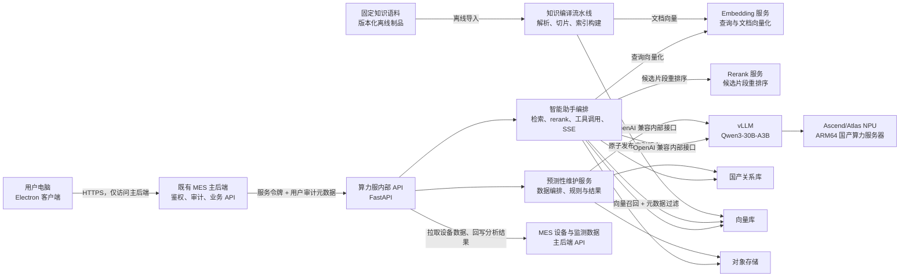
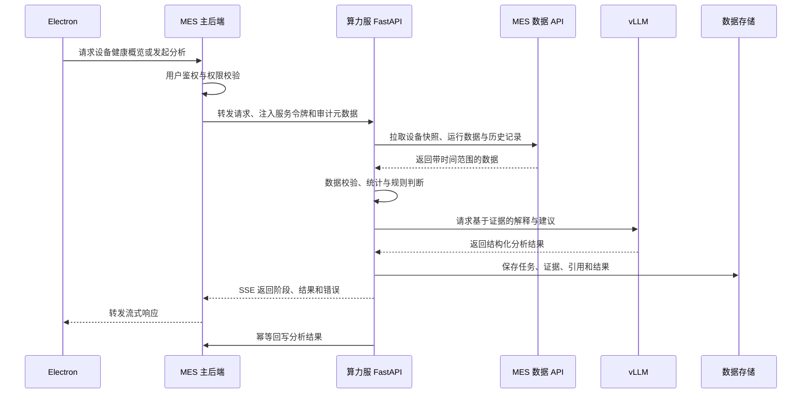
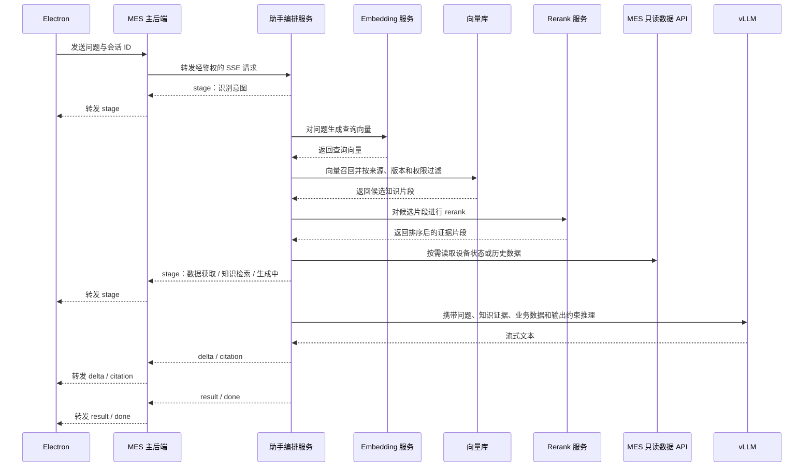
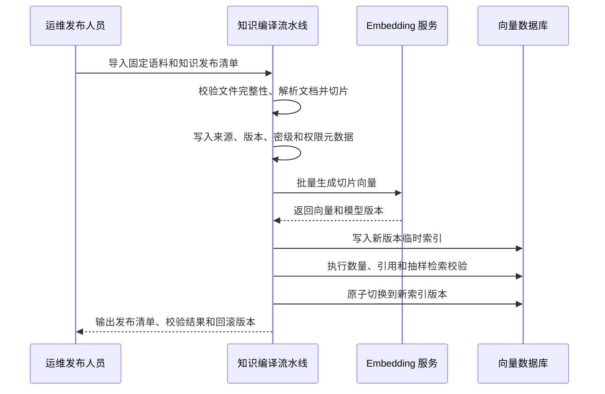

# 设备预测性维护与智能助手系统设计

> 文档状态：技术设计初稿  
> 更新日期：2026-11-04  
> 适用对象：前端、后端、算法、系统集成、测试与部署人员

## 1. 设计目标与约束

本文定义设备预测性维护和智能助手的系统架构、接口、数据流、RAG 服务、部署和安全设计。业务目标、范围和验收标准见 [需求文档](./需求文档.md)。

核心约束：

- 既有 MES 主后端是唯一业务入口，负责用户鉴权、权限判断、审计和请求转发。
- 用户端与主服务器之间的鉴权、通信协议和接入页面由其他团队负责，本文不设计该部分。
- 算力服负责预测分析、完整 RAG 服务和大模型推理，不直接连接 MES 业务数据库。
- 知识库采用固定、预先整理并经版本化发布的离线语料，不提供用户上传或在线管理接口。
- vLLM、embedding、rerank 和向量数据库只允许算力服内部访问。
- Qwen3-30B-A3B 首版采用与目标 CANN/vLLM-Ascend 版本匹配的 W8A8 量化版本。

## 2. 总体架构



### 2.1 网络与信任边界

1. Electron 和算力服位于同一局域网，但用户端只能访问 MES 主后端。
2. 用户认证和权限判断由主后端完成。用户接入和鉴权状态可使用 MQTT 作为轻量控制通道，但模型请求、响应和文件仍通过 HTTPS/SSE 代理。
3. 主后端通过固定服务令牌调用算力服；用户 ID、角色和请求 ID 只作为审计元数据。
4. 算力服只接受主后端所在主机或受控网关的请求。
5. vLLM、embedding、rerank 和向量数据库只监听算力服内部地址。
6. 固定知识语料通过受控制品通道进入算力服，用户端和主服务器不参与知识上传、切片或索引发布。

### 2.2 组件职责

| 组件 | 职责 |
| --- | --- |
| Electron | 展示健康概览、分析结果、助手会话和阶段进度；不持有模型地址、数据库凭据或服务令牌 |
| MES 主后端 | 用户鉴权、权限校验、请求转发、设备数据查询、结果接收和审计 |
| FastAPI 内部 API | 输入校验、服务认证、任务编排、SSE、错误映射和可观测性 |
| 预测性维护服务 | 获取设备快照与历史数据、执行统计和规则判断、组织模型解释、生成并回写结果 |
| 智能助手编排 | 会话管理、查询向量化、知识召回、rerank、只读工具调用、上下文组装、引用整理和流式输出 |
| 知识编译流水线 | 消费固定语料和发布清单，执行解析、切片、元数据校验、embedding 和索引构建 |
| Embedding 服务 | 为查询和知识切片生成向量，仅提供算力服内部调用 |
| Rerank 服务 | 对向量召回候选按问题相关性重新排序，仅提供算力服内部调用 |
| vLLM | 提供受控的 OpenAI 兼容推理接口，不直接面向用户端 |
| 关系库 | 保存分析任务、会话、消息、引用、审计事件和结果索引 |
| 向量库 | 保存知识切片、向量、元数据和可切换的索引版本 |
| 对象存储 | 保存固定知识语料、发布清单、分析报告、大型证据、模型产物和快照 |

## 3. 核心数据流

### 3.1 设备预测性维护



维护分析遵循“确定性规则优先，模型负责解释和组织”的原则。阈值、连续异常、缺失数据和趋势统计由可测试规则完成；模型基于提供的证据生成风险说明、核查方向和维护建议。

### 3.2 智能助手 RAG 链路



助手只拥有只读业务工具。事实性回答必须使用知识片段或业务数据，并附可定位引用；知识无命中、权限不足或数据不足时必须明确说明。

### 3.3 知识编译与发布

知识文档在部署前完成收集和整理。每个发布版本由固定语料和清单构成，离线编译后作为只读知识包部署到算力服：



发布约束：

- 语料、清单和编译产物使用只读版本目录，不允许在运行时直接修改。
- 单次查询固定使用同一个 `KNOWLEDGE_INDEX_VERSION`，索引切换通过原子别名完成，不得混用新旧语料。
- 原始语料、切片元数据、embedding 模型版本、rerank 模型版本和构建时间必须可追溯。
- 知识无命中时不得编造引用；embedding、向量库或检索失败时返回明确错误或按配置降级并标注依据不足。
- 知识库不提供用户上传、删除、审核或索引管理接口。

## 4. 内部接口

以下接口是算力服与主后端之间的初始约定，路径统一使用 `/internal/v1` 前缀，最终以联调合同为准。Electron 不直接调用这些接口。

| 方法 | 路径 | 用途 |
| --- | --- | --- |
| `GET` | `/internal/v1/equipment/health` | 获取指定站点和设备分类的健康快照 |
| `POST` | `/internal/v1/maintenance/analyses` | 创建隔离室、备电或通用维护分析任务 |
| `GET` | `/internal/v1/maintenance/analyses/{analysis_id}/events` | 以 SSE 订阅任务阶段和结果 |
| `GET` | `/internal/v1/maintenance/analyses/{analysis_id}` | 查询已持久化结果，用于断线恢复 |
| `POST` | `/internal/v1/assistant/chat` | 创建或继续助手会话并流式返回内容 |

算力服调用主后端的设备数据和结果回写接口由主后端团队提供，至少覆盖设备主数据、设备快照、时间序列数据、历史维护记录和分析结果回写。

知识更新只通过受控离线制品发布，不新增用户上传、知识管理或索引操作接口。`/internal/v1/assistant/chat` 保持不变，检索、embedding、rerank 和 vLLM 调用均在算力服内部完成。

### 4.1 通用请求头

```http
Authorization: Bearer <COMPUTE_SERVICE_TOKEN>
X-User-Id: <user-id>
X-User-Roles: <role-a,role-b>
X-Request-Id: <uuid>
Idempotency-Key: <uuid>
traceparent: <w3c-trace-context>
```

- `Authorization` 用于验证调用方是已授权的主后端。
- 用户和角色字段只用于审计、展示和业务权限复核，不作为服务认证依据。
- `X-Request-Id` 贯穿主后端、算力服和模型调用日志。
- 创建任务和结果回写必须支持 `Idempotency-Key`。

### 4.2 维护分析请求与结果

创建任务请求示例：

```json
{
  "site_id": "AS01",
  "equipment_ids": ["AS01-ROOM-01"],
  "analysis_type": "isolation_room",
  "time_range": {
    "start": "2026-10-01T00:00:00+08:00",
    "end": "2026-10-12T23:59:59+08:00"
  },
  "options": {
    "include_report": false
  }
}
```

`analysis_type` 初始支持 `isolation_room`、`backup_power` 和 `general`。

任务创建成功返回 `202 Accepted`：

```json
{
  "analysis_id": "ma_01J...",
  "status": "queued"
}
```

最终结果至少包含以下字段：

```json
{
  "analysis_id": "ma_01J...",
  "status": "completed",
  "health_level": "watch",
  "risk_summary": "风险摘要",
  "evidence": [
    {
      "source": "MES 设备历史数据",
      "metric": "示例指标",
      "time_range": "2026-10-01/2026-10-12",
      "observation": "可核查的观测结果"
    }
  ],
  "recommendations": [
    {
      "priority": "medium",
      "action": "建议执行的核查项",
      "rationale": "建议依据",
      "requires_human_confirmation": true
    }
  ],
  "data_gaps": [],
  "confidence": 0.78,
  "generated_at": "2026-10-15T10:20:00+08:00",
  "model": {
    "name": "Qwen3-30B-A3B",
    "precision": "W8A8",
    "revision": "以模型清单为准"
  }
}
```

`status` 使用 `queued`、`running`、`completed`、`partial`、`failed`。`health_level` 使用 `normal`、`watch`、`inspect`、`insufficient_data`。

### 4.3 SSE 事件

| 事件 | 内容 |
| --- | --- |
| `stage` | 当前阶段、用户可见说明和进度 |
| `delta` | 助手文本增量 |
| `citation` | 数据或知识来源、片段标识和链接信息 |
| `result` | 维护分析或助手的结构化最终结果 |
| `error` | 错误码、可重试标记和脱敏说明 |
| `done` | 本次流结束标记 |

每个事件包含单调递增的 `seq`。服务端定期发送 SSE 注释行作为心跳；连接中断后通过 `analysis_id` 或会话 ID 恢复。

## 5. 数据与存储设计

| 数据类别 | 存储 | 说明 |
| --- | --- | --- |
| 设备与业务数据 | MES 主系统 | 算力服通过只读 API 获取，不直接连接业务数据库 |
| 维护任务与结果 | 国产关系库 | 状态、健康等级、证据、建议、模型版本和审计信息 |
| 助手会话与引用 | 国产关系库 | 会话、消息、引用索引、反馈和审计记录 |
| 固定知识语料与发布清单 | 对象存储 | 只读语料包、校验和、解析结果索引和版本记录 |
| 知识切片与向量 | 向量库 | 分片、向量、来源、密级、权限和索引版本元数据 |
| 报告与大型证据 | 对象存储 | Excel、PDF、原始证据快照和模型产物索引 |

建议通过兼容性测试锁定以下产品版本：

- 关系库：openGauss、Kingbase 等兼容 PostgreSQL 的国产数据库。
- 向量库：支持 ARM64 离线部署的国产向量数据库。
- 对象存储：支持 S3 兼容接口、可离线部署的国产对象存储。

知识切片必须保存来源、版本、生效日期、密级和权限范围。发布清单至少记录语料版本、解析器版本、切片策略版本、embedding 模型版本、rerank 模型版本、向量维度、构建时间和校验和。

## 6. 目标环境与部署设计

### 6.1 目标硬件

| 项目 | 配置 |
| --- | --- |
| CPU | 鲲鹏 920-Smart，32 核 |
| 内存 | 128 GB DDR4 2933 |
| 本地存储 | 4 TB M.2 |
| 推理加速 | 昇腾 Atlas 300I A2 64 GB × 1 |
| 电源 | 1250 W ATX |
| 模型 | Qwen3-30B-A3B W8A8 |
| Embedding / Rerank | 位于算力服内部，使用 CPU 或 NPU 由压测决定 |
| 应用服务 | Python + FastAPI，ARM64 容器镜像 |
| 容器 | Docker/containerd，生产环境优先离线镜像 |

Qwen3-30B-A3B 约 305 亿参数，BF16 权重约 61 GB，无法在单张 64 GB 卡上为 KV Cache、运行时和并发预留足够空间。首版按 W8A8 验证；如果单卡无法满足指标，依次优化上下文和缓存参数、增加第二张卡，或改用较小模型。

### 6.2 部署边界

```text
主后端所在网段
  └─ 仅允许访问算力服 FastAPI 的 443/指定内部端口

算力服主机
  ├─ FastAPI 内部 API
  ├─ 固定知识语料 / 知识编译产物
  ├─ Embedding / Rerank 内部服务
  ├─ 关系库 / 向量库 / 对象存储
  └─ vLLM（仅本机或内部容器网络）

用户电脑
  └─ 只访问既有 MES 主后端
```

FastAPI 不把任意用户输入直接转发给 vLLM；请求经过长度限制、权限校验、敏感信息处理和并发控制。vLLM、embedding 和 rerank 不配置公网监听。

### 6.3 发布流程

1. 在 ARM64 目标架构构建 Electron 安装包、FastAPI 镜像和部署组件。
2. 从受控制品库拉取锁定版本的基础镜像、CANN、vLLM 适配组件、Python 依赖和模型。
3. 导出离线包，并为镜像、模型、embedding/rerank 模型、配置和固定知识语料生成 SHA-256 清单。
4. 在隔离网络导入制品，完成数据库、对象存储和知识语料迁移。
5. 执行知识解析、切片、embedding 和索引构建，对临时索引执行数量、元数据、引用和抽样检索校验。
6. 校验通过后原子切换 `KNOWLEDGE_INDEX_VERSION`。
7. 启动服务并执行 LLM、embedding、rerank、RAG、内部 API 和主后端联调检查。
8. 灰度开放功能；故障时切回上一版本镜像、模型、RAG 配置和索引。

具体 `docker run`、`vllm serve` 和 CANN 安装命令应在硬件、驱动和镜像版本确认并通过压测后写入独立部署手册。

## 7. 工程结构与配置

### 7.1 建议工程结构

```text
.
├─ electron/                    # 客户端维护、助手页面
├─ compute-service/
│  ├─ app/
│  │  ├─ api/internal/v1/       # 内部接口与 SSE
│  │  ├─ maintenance/           # 预测分析、规则和结果编排
│  │  ├─ assistant/             # 检索、rerank、上下文组装、工具调用和引用
│  │  ├─ knowledge/             # 固定语料解析、切片、向量化和索引发布
│  │  ├─ integrations/          # MES API、vLLM、embedding 和 rerank 适配
│  │  ├─ persistence/           # 关系库、向量库、对象存储和知识发布清单
│  │  └─ core/                  # 配置、鉴权、日志和错误模型
│  └─ tests/
├─ deploy/
│  ├─ containers/               # ARM64 镜像定义
│  ├─ compose/                  # 局域网部署编排
│  └─ manifests/                # 版本、模型和知识清单
└─ docs/                        # 接口、部署、压测和 RAG 运维文档
```

### 7.2 环境配置

| 变量 | 用途 |
| --- | --- |
| `MES_API_BASE_URL` | MES 主后端内部 API 地址 |
| `COMPUTE_SERVICE_TOKEN` | 主后端调用算力服的服务令牌 |
| `MES_SERVICE_TOKEN` | 算力服调用 MES 数据接口的凭据 |
| `VLLM_BASE_URL` | vLLM 内部 OpenAI 兼容接口地址 |
| `VLLM_MODEL_NAME` | 主模型服务名称 |
| `EMBEDDING_BASE_URL` | embedding 模型内部服务地址 |
| `EMBEDDING_MODEL_NAME` | 文档和查询向量化模型标识 |
| `RERANK_BASE_URL` | rerank 模型内部服务地址 |
| `RERANK_MODEL_NAME` | 候选片段重排序模型标识 |
| `RELATIONAL_DB_DSN` | 国产关系库连接串 |
| `VECTOR_DB_URL` | 向量库地址 |
| `KNOWLEDGE_CORPUS_PATH` | 固定知识语料及发布清单只读路径 |
| `KNOWLEDGE_INDEX_VERSION` | 当前查询固定使用的知识索引版本 |
| `OBJECT_STORAGE_ENDPOINT` | 对象存储内部端点 |
| `OBJECT_STORAGE_BUCKET` | 报告、证据和知识制品存储桶 |
| `LOG_LEVEL` | 日志级别 |
| `SSE_HEARTBEAT_SECONDS` | SSE 心跳间隔 |

密钥、令牌、证书私钥、数据库密码和模型许可证不得提交到版本库。服务令牌支持定期轮换，并区分开发、测试和生产环境。

## 8. 安全、可靠性与可观测性

### 8.1 安全与可靠性

- 使用局域网 ACL 和主机防火墙限制算力服入口，只允许主后端来源地址访问。
- 服务令牌遵循最小权限原则，日志中不得输出完整令牌。
- 对用户问题、设备数据和提示词进行长度及敏感信息检查，日志按需脱敏。
- 知识库只从已批准、固定版本的离线语料包构建，发布前校验清单和 SHA-256。
- 向量召回按来源、版本、密级和权限范围过滤。
- 模型输出经过 JSON Schema 校验，校验失败时重试或返回明确失败。
- 设备数据缺失、索引版本不存在、RAG 依赖不可用、模型超时和回写失败应使用不同错误码。
- 结果回写支持幂等键；SSE 断线不得无限占用长时间模型请求。

### 8.2 可观测性

结构化日志至少包含：

- `timestamp`、`level`、`service`、`environment`。
- `request_id`、`trace_id`、`user_id`、`session_id`、`analysis_id`。
- 数据拉取、embedding、向量检索、rerank、首 token 和完整生成耗时。
- 召回数量、rerank 前后数量、命中文档 ID、引用片段 ID、知识索引版本和发布版本。
- 输入/输出 token 数、模型名称、精度、错误码、可重试标记和降级原因。

健康端点：

- `GET /health/live`：进程是否存活。
- `GET /health/ready`：关系库、向量库、embedding、rerank、对象存储和 vLLM 是否可用，并报告当前知识索引版本。
- `GET /health/model`：模型名称、版本和最近一次推理检查结果。

## 9. 技术测试与验证

### 9.1 功能与接口

- 健康概览、隔离室/备电分析、报告和断线恢复符合业务规则。
- 助手能够完成查询向量化、召回、rerank、上下文组装和带引用回答。
- 无令牌、错误令牌和非主后端来源请求被拒绝并产生审计日志。
- 主后端能够完整代理 SSE，客户端能够识别事件顺序和重复事件。
- 任务创建和结果回写重复请求不会产生重复记录。

### 9.2 RAG 与知识发布

- 固定知识包可在无外网环境构建和启动。
- 临时索引构建失败时继续使用旧索引；新索引校验通过后才允许切换。
- 单次查询不会混用新旧知识版本。
- embedding、rerank 或向量库不可用时返回明确错误或已批准的降级结果。
- 知识无命中时不得生成虚假引用。

### 9.3 安全与性能

- vLLM、embedding、rerank、向量库和算力服内部接口无法从用户电脑直接访问。
- 分别记录 W8A8 模型、embedding、rerank 和向量库的内存/显存占用、吞吐及延迟。
- 压测最大上下文、多用户并发、长时间稳定性和端到端 RAG 延迟。
- 验证隔离网络启动、知识发布、故障恢复、版本回滚和离线安装流程。

## 10. 待确认技术事项

| 类别 | 待确认内容 | 影响 |
| --- | --- | --- |
| 硬件 | CANN、NPU 驱动和平台版本，磁盘冗余方案 | 决定镜像、设备挂载和可靠性 |
| 推理 | vLLM-Ascend、模型修订号、量化和许可证 | 决定部署命令与性能 |
| 模型容量 | 单卡 W8A8 的上下文、并发、延迟和吞吐 | 决定是否增加第二张卡或缩小模型 |
| RAG | embedding/rerank 模型、CPU/NPU 部署、检索参数 | 决定资源配额和回答质量 |
| 数据库 | 关系库、向量库和对象存储产品版本 | 决定索引发布、备份和迁移方案 |
| 主后端 | SSE 代理、服务令牌轮换、设备数据和回写接口 | 阻塞端到端联调 |

## 11. 参考

- [需求文档](./需求文档.md)
- [离线界面演示](./打开工作站.html)
